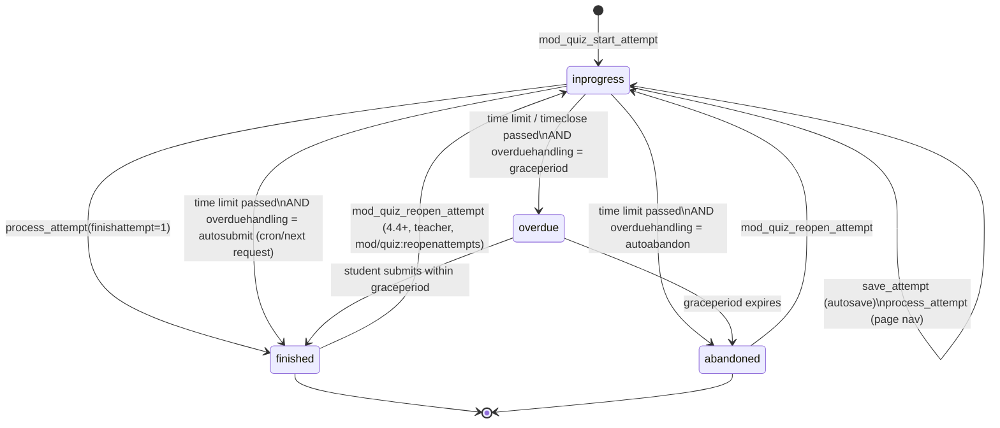

# Moodle Activity Modules (`mod_*`) — Integration Reference

**Target version:** Moodle 4.5 LTS (`MOODLE_405_STABLE`).
**Live verification host:** `moodle.tuni.fi`, **Moodle 4.5.13** (Build 20260810, `version = 2024100713`), read-only student token, verified **2026-09-03**. Every JSON block tagged *verified on 4.5.13* is a real, trimmed response from that host. Blocks tagged *from source* are derived from `mod/<name>/classes/external*.php` return declarations because that module type is not installed / not present on the verification host.

---

## What this covers

One `##` section per activity module: what it stores in the database, what state machine it moves through, which web-service functions read and write it, the actual shape of the API response, how it feeds the gradebook, and the traps.

## What lives in the sibling docs (do not duplicate — cross-reference)

| Sibling | Owns |
|---|---|
| `web-services-api.md` | Transports (REST/XML-RPC), tokens, `wstoken`/`moodlewsrestformat`, service configuration, exception/error-code semantics, the cross-domain `core_*` function catalogue, rate/permission mechanics. |
| `data-model.md` | Contexts, roles, capabilities, course/section/course-module structure, gradebook internals (`grade_items`/`grade_grades`), activity completion, calendar/events, the Files API and `pluginfile.php` addressing. |
| `integration-cookbook.md` | Practical patterns, sync strategies, pagination, pitfalls, debugging recipes. |

When this document says "the file descriptor shape" or "the grade item", the authority is `data-model.md`. When it says "this raises `nopermissions`", the authority is `web-services-api.md`.

---

## Table of contents

- [Cross-cutting conventions](#cross-cutting-conventions)
- [Summary table](#summary-table)
- **Graded / interactive**
  - [`assign` — Assignment](#assign--assignment)
  - [`quiz` — Quiz](#quiz--quiz)
  - [`workshop` — Workshop (peer assessment)](#workshop--workshop-peer-assessment)
  - [`lesson` — Lesson](#lesson--lesson)
  - [`scorm` — SCORM package](#scorm--scorm-package)
  - [`h5pactivity` — H5P](#h5pactivity--h5p)
  - [`feedback` — Feedback](#feedback--feedback)
  - [`choice` — Choice](#choice--choice)
  - [`data` — Database](#data--database)
  - [`glossary` — Glossary](#glossary--glossary)
  - [`wiki` — Wiki](#wiki--wiki)
  - [`survey` — Survey (legacy)](#survey--survey-legacy)
- **Communication / collaboration**
  - [`forum` — Forum](#forum--forum)
  - [`chat` — Chat](#chat--chat)
  - [`bigbluebuttonbn` — BigBlueButton](#bigbluebuttonbn--bigbluebutton)
- **External**
  - [`lti` — External tool](#lti--external-tool)
- **Content / resource**
  - [Shared model for content modules](#shared-model-for-content-modules)
  - [`resource` — File](#resource--file)
  - [`folder` — Folder](#folder--folder)
  - [`page` — Page](#page--page)
  - [`book` — Book](#book--book)
  - [`url` — URL](#url--url)
  - [`label` — Text and media area](#label--text-and-media-area)
  - [`imscp` — IMS content package](#imscp--ims-content-package)
  - [`subsection` — Subsection (4.5+)](#subsection--subsection-45)
- [Appendix A — module presence on the verification host](#appendix-a--module-presence-on-the-verification-host)
- [Appendix B — full `mod_*` web-service catalogue](#appendix-b--full-mod_-web-service-catalogue)

---

## Cross-cutting conventions

These hold for nearly every module and are not repeated in each section.

### 1. Two ways to see an activity

1. **`core_course_get_contents(courseid)`** — the course-page view. Returns sections, each with `modules[]`. Every module entry has `id` (the **course module id**, `cmid`), `instance` (the **module instance id**, i.e. the PK in the `mod_<name>` table), `modname`, `contextid`, `url`, `visible`, `uservisible`, `customdata`, `dates[]`, `completiondata`, and — for content modules — `contents[]` + `contentsinfo`. This is the cheapest way to enumerate everything in a course in one call.
2. **`mod_<name>_get_<name>s_by_courses(courseids[])`** — the per-module view. Returns the full module instance record (settings), with `id` = instance id and `coursemodule` (or `cmid` for forum/assign) = cmid.

**`id` means different things in the two calls.** In `core_course_get_contents` the `id` is the cmid and `instance` is the instance id. In `mod_*_get_*_by_courses` the `id` is the instance id. Almost every module-level web service takes the **instance id** (`quizid`, `assignid`, `forumid`, `workshopid`, …), never the cmid — the exceptions are `mod_h5pactivity_*` (`h5pactivityid` is a **cmid**) and `mod_lesson_get_page_data` variants which take `lessonid` (instance).

### 2. The `standard_coursemodule_elements` shape

Newer `get_*_by_courses` implementations build their reply from `core_course\external\helper_for_get_mods_by_courses::standard_coursemodule_element_values()` (`course/classes/external/helper_for_get_mods_by_courses.php`):

```
id, coursemodule, course, name, lang        ← always
intro, introformat, introfiles              ← if the caller has the module's view capability
section, visible, groupmode, groupingid     ← only if the caller has moodle/course:manageactivities
```

**Gotcha (verified on 4.5.13):** older, hand-rolled implementations — `mod_resource`, `mod_url`, `mod_quiz`, `mod_choice`, `mod_forum` — return the raw `get_all_instances_in_courses()` record and therefore leak `section`, `visible`, `groupmode`, `groupingid` to plain students too. Do not treat the presence of those fields as a permission signal.

### 3. `warnings[]` instead of exceptions

Bulk read functions never throw for one bad item; they push a warning and omit it. A caller that ignores `warnings[]` silently loses data. Real example (student token asking for teacher-only data):

```json
{
  "assignments": [],
  "warnings": [
    {"item": "assignment", "itemid": 284465, "warningcode": "1", "message": "No access rights in module context"}
  ]
}
```
*verified on 4.5.13 — `mod_assign_get_grades`*

### 4. Text fields come in pairs

`intro`/`introformat`, `content`/`contentformat`, `message`/`messageformat`, `definition`/`definitionformat`. The format is `FORMAT_MOODLE=0`, `FORMAT_HTML=1`, `FORMAT_PLAIN=2`, `FORMAT_MARKDOWN=4`. By the time text reaches a web service it has normally already been run through `format_text()` with `noclean`, so you receive HTML with rewritten `@@PLUGINFILE@@` URLs — **except** in a handful of functions that return raw stored text (`mod_page`'s `content`, `mod_book` chapter content, `mod_data` templates). See `data-model.md` for `@@PLUGINFILE@@` rewriting rules.

### 5. File descriptors

Any `*files`/`introfiles`/`attachments`/`contentfiles` array uses the standard descriptor:

```json
{
  "filename": "E01 Introduction.pdf",
  "filepath": "/",
  "filesize": 46146,
  "fileurl": "https://moodle.tuni.fi/webservice/pluginfile.php/5290389/mod_assign/introattachment/0/E01%20Introduction.pdf",
  "timemodified": 1748953243,
  "mimetype": "application/pdf",
  "isexternalfile": false,
  "icon": "f/pdf"
}
```
*verified on 4.5.13 — `mod_assign_get_assignments`, `introattachments[]`*

`fileurl` under `/webservice/pluginfile.php/` needs `?token=<wstoken>` (or a POSTed `token`) to download; `/pluginfile.php/` variants need a session cookie. `core_course_get_contents` returns `contents[].fileurl` with `?forcedownload=1` already appended.

### 6. `type => 'write'` in `db/services.php` is not a promise

Several read-shaped functions are declared `write` because they log a view event and can update completion: every `mod_*_view_*` function. Conversely `mod_lti_view_lti` is declared `type => 'read'` in `mod/lti/db/services.php` even though it triggers a course-module-viewed event — a long-standing core inconsistency. **For a read-only integration, allowlist by name prefix (`_get_`, `_search_`, `_is_`, `_can_`, `_check_`), not by the declared `type`.**

### 7. Grading

Only `assign`, `quiz`, `workshop`, `lesson`, `scorm`, `h5pactivity`, `data`, `glossary`, `forum` (advanced grading), and `lti` push grade items. Everything else (`choice`, `feedback`, `survey`, `wiki`, `chat`, all content modules) is ungraded. Read grades generically through `gradereport_user_get_grade_items` / `core_grades_get_grades` (see `data-model.md`) rather than per-module functions — the per-module ones are almost always teacher-capability gated.

---

## Summary table

| Module | Instance table | WS read | WS write | Gradebook | Content readable via API? |
|---|---|---|---|---|---|
| `assign` | `assign` | rich | rich | yes (1 item; `itemnumber 0`) | yes — submissions, feedback, files |
| `quiz` | `quiz` | rich | rich (attempt lifecycle) | yes (1+ items since 4.4) | partly — questions arrive as **rendered HTML** |
| `workshop` | `workshop` | rich | rich | yes (**2** items: submission + assessment) | yes — submissions, assessments, form definition |
| `lesson` | `lesson` | rich | rich (attempt lifecycle) | yes (1 item) | yes — pages, answers, attempts |
| `scorm` | `scorm` | good | `insert_scorm_tracks`, `launch_sco` | yes (1 item) | metadata + CMI datamodel only; content is a zip |
| `h5pactivity` | `h5pactivity` | good | view/log only | yes (1 item) | attempts + xAPI-derived results; content is an `.h5p` |
| `feedback` | `feedback` | rich | `launch/process_page` | no | yes — items, analysis, responses |
| `choice` | `choice` | good | submit/delete response | no | yes — options + counts (names gated by `publish`) |
| `data` | `data` | rich | add/update/delete/approve entry | yes (ratings) | yes — fields + records + contents |
| `glossary` | `glossary` | rich | add/update/delete entry | yes (ratings) | yes — entries, categories, attachments |
| `wiki` | `wiki` | good | `new_page`, `edit_page` | no | yes — page `cachedcontent` |
| `survey` | `survey` | minimal | `submit_answers` | no | question templates only |
| `forum` | `forum` | rich | post/discussion/lock/pin/subscribe | yes if `grade_forum` set (whole-forum grading) | yes — discussions, posts, attachments |
| `chat` | `chat` | good | `login_user`, `send_chat_message` | no | yes — live + archived messages |
| `bigbluebuttonbn` | `bigbluebuttonbn` | good | `get_join_url`, `end_meeting`, `update_recording` | completion only, no grade item | recordings metadata only |
| `lti` | `lti` | **thin** | admin/tool-type management only | yes if `instructorchoiceacceptgrades` | **no — opaque**, see section |
| `resource` | `resource` | list + files | view only | no | yes — the file(s) |
| `folder` | `folder` | list + files | view only | no | yes — the files |
| `page` | `page` | list | view only | no | yes — `content` |
| `book` | `book` | list only | view only | no | **chapters have no WS**; only `core_course_get_contents` |
| `url` | `url` | list | view only | no | yes — `externalurl` |
| `label` | `label` | list | none | no | yes — `intro` is the whole thing |
| `imscp` | `imscp` | list | view only | no | `structure` blob + files |
| `subsection` | `subsection` | **none** | none | no | via `core_course_get_contents` only |

"rich" = ≥8 read functions covering configuration, state and content. "thin" = name/config only.

---

## `assign` — Assignment

**Purpose:** collect student work (files, online text, comments), grade it, return feedback — the most heavily used graded activity and by far the richest web-service surface.

### Key DB tables

`mod/assign/db/install.xml`

| Table | Notable columns |
|---|---|
| `assign` | `course`, `name`, `intro`/`introformat`, `activity`/`activityformat` (4.3+ "Activity instructions", separate from intro), `alwaysshowdescription`, `nosubmissions`, `submissiondrafts`, `sendnotifications`, `sendlatenotifications`, `sendstudentnotifications`, **`duedate`**, **`allowsubmissionsfromdate`**, **`cutoffdate`**, **`gradingduedate`**, `grade` (max grade; **negative = scale id**), `timelimit` (4.0+), `submissionattachments`, `requiresubmissionstatement`, `completionsubmit`, `teamsubmission`, `requireallteammemberssubmit`, `teamsubmissiongroupingid`, `preventsubmissionnotingroup`, `blindmarking`, `revealidentities`, `hidegrader`, `markinganonymous`, `attemptreopenmethod` (default `untilpass`), `maxattempts` (default 1, `-1` = unlimited), `markingworkflow`, `markingallocation` |
| `assign_submission` | `assignment`, `userid`, `groupid`, `attemptnumber` (0-based), `status`, `latest` (1 on the current attempt row), `timecreated`, `timemodified`, `timestarted` (set when `timelimit` in use) |
| `assign_grades` | `assignment`, `userid`, `grader`, `attemptnumber`, `grade` (float; `-1` = not set), `timecreated`, `timemodified` |
| `assign_user_flags` | `userid`, `assignment`, `locked`, `mailed`, **`extensionduedate`**, **`workflowstate`**, **`allocatedmarker`** |
| `assign_plugin_config` | `assignment`, `plugin`, `subtype` (`assignsubmission`\|`assignfeedback`), `name`, `value` — one row per subplugin setting; this is what `configs[]` in the API is |
| `assign_user_mapping` | `assignment`, `userid` — the blind-marking anonymous-id map (`id` is the "Participant N" number) |
| `assign_overrides` | `assignid`, `groupid`/`userid`, `allowsubmissionsfromdate`, `duedate`, `cutoffdate`, `timelimit` |

There is **no** `assign_attempts` table: an attempt *is* a row in `assign_submission` with a distinct `attemptnumber`; only one has `latest = 1`.

### Subplugins (config plugins)

Two subplugin types, both stored in `assign_plugin_config`:

- **`assignsubmission_*`** (core: `file`, `onlinetext`, `comments`) — what a student may submit.
  - `file`: `enabled`, `maxfilesubmissions`, `maxsubmissionsizebytes`, `filetypeslist`
  - `onlinetext`: `enabled`, `wordlimitenabled`, `wordlimit`
  - `comments`: `enabled` only (it is the core comments API, not an assign file area)
- **`assignfeedback_*`** (core: `comments`, `file`, `editpdf`, `offline`) — how a marker returns feedback.
  - `comments`: `enabled`, `commentinline`
  - `file`: `enabled`
  - `editpdf`: `enabled`, plus stamp config

Real `configs[]` (*verified on 4.5.13*, course 58630, assign 285439):

```json
"configs": [
  {"plugin":"file","subtype":"assignsubmission","name":"enabled","value":"1"},
  {"plugin":"file","subtype":"assignsubmission","name":"maxfilesubmissions","value":"20"},
  {"plugin":"file","subtype":"assignsubmission","name":"maxsubmissionsizebytes","value":"104857600"},
  {"plugin":"file","subtype":"assignsubmission","name":"filetypeslist","value":""},
  {"plugin":"comments","subtype":"assignsubmission","name":"enabled","value":"1"},
  {"plugin":"comments","subtype":"assignfeedback","name":"enabled","value":"1"},
  {"plugin":"comments","subtype":"assignfeedback","name":"commentinline","value":"0"}
]
```

**`configs[]` semantics:** a flat, unordered list of `(subtype, plugin, name, value)` quadruples with **all values as strings**. A plugin that is disabled usually contributes no rows at all rather than `enabled=0` — so "`onlinetext` absent" means "online text submission is off". Always reduce to a map keyed by `subtype + '_' + plugin` before reading.

### Dates: the four of them

| Field | Meaning | Effect |
|---|---|---|
| `allowsubmissionsfromdate` | opens submission | before it, saving is blocked and students see the description only if `alwaysshowdescription` |
| `duedate` | soft deadline | after it, submissions are flagged **late**; still accepted |
| `cutoffdate` | hard deadline | after it, submission is refused entirely. `0` = no cutoff |
| `gradingduedate` | expected marking deadline | teacher-facing only; drives the "grading due" calendar event, never blocks anything |

**Extensions** live per user in `assign_user_flags.extensionduedate` and surface as `lastattempt.extensionduedate` in `get_submission_status` (`null` when none). An extension overrides both `duedate` and `cutoffdate` for that user. Group/user **overrides** (`assign_overrides`) are a different mechanism and are **not exposed by any `mod_assign_*` web service** in 4.5 — you can only see their effect indirectly through `get_submission_status`.

### Submission status state machine

Constants from `mod/assign/locallib.php` lines 30–33:

```
ASSIGN_SUBMISSION_STATUS_NEW       = 'new'
ASSIGN_SUBMISSION_STATUS_DRAFT     = 'draft'
ASSIGN_SUBMISSION_STATUS_SUBMITTED = 'submitted'
ASSIGN_SUBMISSION_STATUS_REOPENED  = 'reopened'
```

```
                       (row created on first view / start_submission)
                                    │
                                    ▼
                                 ┌─────┐
                                 │ new │
                                 └──┬──┘
              submissiondrafts=1    │    submissiondrafts=0
        save_submission ────────────┤────────────► save_submission
                    │               │                     │
                    ▼               │                     ▼
                ┌───────┐  submit_for_grading      ┌───────────┐
                │ draft │ ───────────────────────► │ submitted │
                └───────┘                          └─────┬─────┘
                    ▲                                    │
                    │  revert_submissions_to_draft       │  grade saved with
                    └────────────────────────────────────┤  addattempt=1, or
                                                         │  attemptreopenmethod
                                                         ▼
                                                   ┌──────────┐
                                                   │ reopened │ (new row,
                                                   └────┬─────┘  attemptnumber+1,
                                                        │        latest=1)
                                       save_submission  │
                                                        ▼
                                                   ┌───────────┐
                                                   │ submitted │
                                                   └───────────┘
```

- With `submissiondrafts = 0` (the common case) `save_submission` moves `new → submitted` directly; there is no draft stage and `submit_for_grading` is unnecessary.
- `remove_submission` (4.2+) empties the current attempt and returns it to `new`.
- `lock_submissions`/`unlock_submissions` set `assign_user_flags.locked` — orthogonal to `status`; surfaces as `lastattempt.locked`.

### Attempts and `attemptreopenmethod`

`mod/assign/locallib.php` lines 54–57:

| Value | Behaviour |
|---|---|
| `none` | one attempt, ever |
| `manual` | a marker explicitly reopens (`addattempt` flag on the grading form) |
| `automatic` | reopened automatically after every grade, up to `maxattempts` |
| `untilpass` | reopened automatically until the grade reaches the gradebook **pass mark** (`grade_items.gradepass`), up to `maxattempts` |

`untilpass` is the **installation default in 4.5** (`attemptreopenmethod` column default is `untilpass`, and `mod/assign/locallib.php:787` falls back to it). Both live courses on the verification host show `"attemptreopenmethod": "untilpass"` with `"maxattempts": 1`, which effectively means "one attempt" — do not infer "multiple attempts allowed" from the method alone; check `maxattempts` too. `ASSIGN_UNLIMITED_ATTEMPTS = -1`.

### Grading status state machine

```
ASSIGN_GRADING_STATUS_NOT_GRADED = 'notgraded'
ASSIGN_GRADING_STATUS_GRADED     = 'graded'
```

`gradingstatus` in the API is produced by `assign::get_grading_status()` (`mod/assign/locallib.php:9432`) and is **polymorphic**:

```php
if ($this->get_instance()->markingworkflow) {
    return $flags->workflowstate ?: ASSIGN_MARKING_WORKFLOW_STATE_NOTMARKED;
}
return ($grade && $grade->grade !== null && $grade->grade >= 0)
        ? ASSIGN_GRADING_STATUS_GRADED : ASSIGN_GRADING_STATUS_NOT_GRADED;
```

So with `markingworkflow = 1` the field carries a **marking workflow state** instead (`mod/assign/locallib.php:70-75`):

```
notmarked → inmarking → readyforreview → inreview → readyforrelease → released
```

Only `released` makes the grade visible to the student. A client must therefore branch on the assignment's `markingworkflow` flag before interpreting `gradingstatus`; the declared PARAM type is `PARAM_ALPHANUMEXT`, i.e. anything.

`gradingreopened` is **not** a 4.5 core constant — you may see it in older mobile-app code and in some third-party docs; in 4.5 the "attempt was reopened after grading" condition is expressed as `submission.status == 'reopened'` while a `feedback.grade` exists for the previous `attemptnumber`.

### Blind marking

`blindmarking = 1` hides student identity from markers. `assign_user_mapping.id` is the anonymous "Participant N" number. `revealidentities` is a one-way switch (`mod_assign_reveal_identities`) — irreversible. `markinganonymous` (4.1+) additionally hides the *marker* identity in the workflow. `mod_assign_get_user_mappings` returns the map (requires `mod/assign:revealidentities` or grading capability).

### Team submission

`teamsubmission = 1`: one submission row per group (`assign_submission.groupid != 0`, `userid = 0`). `requireallteammemberssubmit` forces every member to press submit. `teamsubmissiongroupingid` restricts which grouping defines the teams. `preventsubmissionnotingroup` blocks ungrouped students. In `get_submission_status` the group's row appears as `lastattempt.teamsubmission` (alongside the user's own `lastattempt.submission`), plus `lastattempt.submissiongroup` and `lastattempt.submissiongroupmemberswhoneedtosubmit[]`.

### Web services

**Read set** (`mod/assign/db/services.php`)

| Function | Key params | Returns |
|---|---|---|
| `mod_assign_get_assignments` | `courseids[]`, `capabilities[]`, `includenotenrolledcourses` | courses → assignments with all settings + `configs[]` + `introattachments[]` |
| `mod_assign_get_submission_status` | `assignid`, `userid`, `groupid` | the whole per-user view: `lastattempt`, `feedback`, `previousattempts[]`, `gradingsummary`, `assignmentdata` |
| `mod_assign_get_submissions` | `assignmentids[]`, `status`, `since`, `before` | all submissions — **teacher only** |
| `mod_assign_get_grades` | `assignmentids[]`, `since` | all grades — **teacher only** |
| `mod_assign_get_user_flags` | `assignmentids[]` | locked / extension / workflow / allocated marker — **teacher only** |
| `mod_assign_get_user_mappings` | `assignmentids[]` | blind-marking id map — **teacher only** |
| `mod_assign_list_participants` | `assignid`, `groupid`, `filter`, `onlyids`, `includeenrolments`, `tablesort` | participants + their submission/grading state |
| `mod_assign_get_participant` | `assignid`, `userid`, `embeduser` | one participant |

**Write set**

`save_submission` (`assignmentid`, `plugindata`), `submit_for_grading` (`assignmentid`, `acceptsubmissionstatement`), `start_submission` (`assignid` — creates the `new` row, needed when `timelimit` is set), `remove_submission`, `copy_previous_attempt`, `save_grade` (`assignmentid`, `userid`, `grade`, `attemptnumber`, `addattempt`, `workflowstate`, `applytoall`, `plugindata`), `save_grades` (bulk), `submit_grading_form`, `save_user_extensions` (`assignmentid`, `userids[]`, `dates[]`), `set_user_flags`, `lock_submissions`, `unlock_submissions`, `revert_submissions_to_draft`, `reveal_identities`, plus the view loggers `view_assign`, `view_submission_status`, `view_grading_table`.

`plugindata` for `save_submission` is keyed by subplugin: `onlinetext_editor[text]`, `onlinetext_editor[format]`, `onlinetext_editor[itemid]`, `files_filemanager` (a **draft item id** obtained through `/webservice/upload.php` or `core_files_upload`). `/webservice/upload.php` accepts multipart `token`, `itemid` (0 to allocate, positive to reuse), `filepath`, and file parts; inspect per-file JSON errors even after HTTP 200.

### Response shapes

`mod_assign_get_assignments` — *verified on 4.5.13*, course 58630:

```json
{
  "courses": [{
    "id": 58630,
    "fullname": "TUTA.015-2026-2027-1 Basics of Industrial Management …",
    "shortname": "TUTA.015-2026-2027-1-TAU",
    "timemodified": 1787392549,
    "assignments": [{
      "id": 285439,
      "cmid": 4461003,
      "course": 58630,
      "name": "Learning Diary Week 01",
      "nosubmissions": 0,
      "submissiondrafts": 0,
      "sendnotifications": 0,
      "sendlatenotifications": 0,
      "sendstudentnotifications": 1,
      "duedate": 1788433200,
      "allowsubmissionsfromdate": 1788210000,
      "grade": 100,
      "timemodified": 1788242926,
      "completionsubmit": 1,
      "cutoffdate": 0,
      "gradingduedate": 1789419600,
      "teamsubmission": 0,
      "requireallteammemberssubmit": 0,
      "teamsubmissiongroupingid": 0,
      "blindmarking": 0,
      "hidegrader": 0,
      "revealidentities": 0,
      "attemptreopenmethod": "untilpass",
      "maxattempts": 1,
      "markingworkflow": 0,
      "markingallocation": 0,
      "markinganonymous": 0,
      "requiresubmissionstatement": 0,
      "preventsubmissionnotingroup": 0,
      "configs": [ /* see above */ ],
      "intro": "",
      "introformat": 1,
      "introfiles": [],
      "introattachments": [],
      "timelimit": 0,
      "submissionattachments": 0
    }]
  }],
  "warnings": []
}
```

Note `cmid` here (not `coursemodule`) — `mod_assign` predates the shared helper.

**`intro` vs `introattachments` vs submission files.** `intro`/`introfiles` are the assignment description and any files embedded *inside* it (`@@PLUGINFILE@@` in the editor, file area `mod_assign/intro`). `introattachments[]` is a **separate** file area (`ASSIGN_INTROATTACHMENT_FILEAREA = 'introattachment'`, `locallib.php:81`) holding "Additional files" the teacher attaches for download — this is where handout PDFs live. `activity`/`activityformat` + the `activityattachment` area (4.3+, `locallib.php:84`) are a third channel, shown only once the student has started. Submission files live in `mod_assign/submission_files` and are reachable only through `get_submission_status` → `lastattempt.submission.plugins[].fileareas[].files[]`.

`mod_assign_get_submission_status` — *verified on 4.5.13*, student's own view of assign 285439:

```json
{
  "lastattempt": {
    "submission": {
      "id": 6352268,
      "userid": 135266,
      "attemptnumber": 0,
      "timecreated": 1788256785,
      "timemodified": 1788256785,
      "timestarted": null,
      "status": "new",
      "groupid": 0,
      "assignment": 285439,
      "latest": 1,
      "plugins": [
        {"type":"file","name":"File submissions","fileareas":[{"area":"submission_files","files":[]}]},
        {"type":"comments","name":"Submission comments"}
      ]
    },
    "submissiongroupmemberswhoneedtosubmit": [],
    "submissionsenabled": true,
    "locked": false,
    "graded": false,
    "canedit": true,
    "caneditowner": true,
    "cansubmit": false,
    "extensionduedate": null,
    "timelimit": 0,
    "blindmarking": false,
    "gradingstatus": "notgraded",
    "usergroups": []
  },
  "assignmentdata": {"attachments": {"intro": []}},
  "warnings": []
}
```

Full declared structure (`mod/assign/externallib.php`, `get_submission_status_returns`):

```
gradingsummary      (teachers only): participantcount, submissiondraftscount, submissionsenabled,
                    submissionssubmittedcount, submissionsneedgradingcount, warnofungroupedusers
lastattempt       : submission{…}, teamsubmission{…}, submissiongroup, submissiongroupmemberswhoneedtosubmit[],
                    submissionsenabled, locked, graded, canedit, caneditowner, cansubmit,
                    extensionduedate, timelimit, blindmarking, gradingstatus, usergroups[]
feedback          : grade{id, assignment, userid, attemptnumber, timecreated, timemodified,
                    grader (-1 when hidden), grade, gradefordisplay}, gradefordisplay, gradeddate,
                    plugins[]{type, name, fileareas[]{area, files[]}, editorfields[]{name,description,text,format}}
previousattempts[]: attemptnumber, submission{…}, grade{…}, feedbackplugins[]
assignmentdata    : attachments{intro[], activity[]}, activity, activityformat
```

`cansubmit: false` above with `status: "new"` does **not** mean saving is blocked: this no-draft assignment can still be edited because `submissionsenabled: true` and `canedit: true`. `cansubmit` describes the separate finalization action used for drafts; check `submissionsenabled` and `canedit` before `save_submission`.

### Gradebook interaction

One grade item, `itemmodule = 'assign'`, `itemnumber = 0`, `iteminstance = assign.id`. `assign.grade > 0` = points out of that max; `assign.grade < 0` = `-scaleid`; `assign.grade = 0` = ungraded. Grades pushed on `save_grade`/`save_grades` and on marking-workflow release. `hidegrader = 1` hides the grader identity (API returns `grader: -1`). Feedback comments are *not* in the gradebook feedback field unless `assignfeedback_comments` is enabled.

### Gotchas

- `get_submission_status` **creates** an `assign_submission` row with `status = 'new'` the first time a student's status is computed. That is a write side-effect of a `_get_` function. Harmless, but it means a "read-only" crawl can create rows.
- `get_submissions`/`get_grades`/`get_user_flags`/`get_user_mappings` all fail *silently* into `warnings[]` for a student token. Never conclude "no submissions" from an empty `assignments[]`.
- `grade` in `assign_grades` is `-1` when unset, but the API `feedback.grade.grade` is a **string** float.
- `attemptnumber` is 0-based everywhere. `previousattempts[]` excludes the current one.
- `timelimit > 0` requires `mod_assign_start_submission` before editing; `timestarted` then drives the countdown.
- `nosubmissions = 1` means "offline assignment" — no submission plugins at all, grading only.
- `duedate`/`cutoffdate` of `0` mean "unset", not "epoch".
---

## `quiz` — Quiz

**Purpose:** timed, auto-marked assessment built out of the core question engine; the only module whose content a client cannot meaningfully re-render itself.

### Key DB tables

`mod/quiz/db/install.xml`

| Table | Notable columns |
|---|---|
| `quiz` | `timeopen`, `timeclose`, **`timelimit`** (seconds; 0 = none), `overduehandling` (`autosubmit`\|`graceperiod`\|`autoabandon`), `graceperiod`, `preferredbehaviour` (`deferredfeedback`, `immediatefeedback`, `interactive`, `adaptive`, `adaptivenopenalty`, `manualgraded`, `immediatecbm`, `deferredcbm`), `canredoquestions`, **`attempts`** (0 = unlimited), `attemptonlast`, **`grademethod`**, `decimalpoints`, `questiondecimalpoints`, `review*` (8 bitmask columns), `questionsperpage`, `navmethod` (`free`\|`sequential`), `shuffleanswers`, **`sumgrades`**, **`grade`**, `password`, `subnet`, `browsersecurity`, `delay1`/`delay2`, `completionattemptsexhausted`, `completionminattempts`, `allowofflineattempts` |
| `quiz_slots` | `slot`, `quizid`, `page`, `displaynumber`, `requireprevious`, `maxmark`, `quizgradeitemid` (4.4+) |
| `quiz_sections` | `quizid`, `firstslot`, `shufflequestions` |
| `quiz_grade_items` | (4.4+) `quizid`, `sortorder`, `name` — multiple gradebook items per quiz |
| `quiz_attempts` | `quiz`, `userid`, `attempt` (1-based), **`uniqueid`** (→ `question_usages.id`), `layout`, `currentpage`, `preview`, **`state`**, `timestart`, `timefinish`, `timemodified`, `timemodifiedoffline`, `timecheckstate`, `sumgrades`, `gradednotificationsenttime` |
| `quiz_grades` | `quiz`, `userid`, `grade` (the aggregated grade, out of `quiz.grade`), `timemodified` |
| `quiz_feedback` | `quizid`, `feedbacktext`/`feedbacktextformat`, `mingrade`, `maxgrade` — overall feedback bands |
| `quiz_overrides` | `quiz`, `groupid`/`userid`, `timeopen`, `timeclose`, `timelimit`, `attempts`, `password` |

The **answers** are not in a `mod_quiz` table at all: they live in the core question engine (`question_usages`, `question_attempts`, `question_attempt_steps`, `question_attempt_step_data`), keyed by `quiz_attempts.uniqueid`. There is no web service that exposes those rows structurally.

### Attempt state machine

`mod/quiz/classes/quiz_attempt.php` lines 57–63:

```
IN_PROGRESS = 'inprogress'   OVERDUE = 'overdue'
FINISHED    = 'finished'     ABANDONED = 'abandoned'
```



State transitions are lazy: an expired attempt stays `inprogress` in the DB until something (cron `\mod_quiz\task\update_overdue_attempts`, or the next request touching it) processes it. **An API reader will therefore see `inprogress` attempts that are logically over.** Compare `timestart + timelimit` and `quiz.timeclose` against now.

### Client attempt lifecycle

```
mod_quiz_get_quiz_access_information(quizid)          → can I attempt at all?
mod_quiz_get_attempt_access_information(quizid,       → is there an unfinished attempt?
                                        attemptid?)     what preflight data is needed?
mod_quiz_start_attempt(quizid, preflightdata[], forcenew)   ⚠ WRITE — burns an attempt
   ↓ returns attempt{id, state:'inprogress', …}
mod_quiz_get_attempt_data(attemptid, page, preflightdata[]) → questions[] as HTML for that page
   ↓ user answers
mod_quiz_save_attempt(attemptid, data[], preflightdata[])   ⚠ autosave, no state change
mod_quiz_process_attempt(attemptid, data[], finishattempt,  ⚠ process or finish
                         timeup, preflightdata[])
   ↓ returns {state, warnings} (new attempt state)
mod_quiz_get_attempt_summary(attemptid, preflightdata[])    → the "finish attempt?" table
mod_quiz_get_attempt_review(attemptid, page)                → post-hoc review
```

`preflightdata` is an array of `{name, value}` pairs carrying access-rule input — in practice `{"name":"quizpassword","value":"…"}` for `quizaccess_password`. Any active rule that needs input declares it; `get_attempt_access_information` tells you which rules are active.

`data[]` in `save_attempt`/`process_attempt` uses the raw question-engine field names taken out of the rendered HTML, e.g. `q3292342:5_answer`, `q3292342:5_:sequencecheck`, `q3292342:5_:flagged`. The `sequencecheck` value must match what the server last sent or the submission is rejected — this is the engine's optimistic-concurrency guard.

### Access rules

`mod_quiz_get_quiz_access_information` — *verified on 4.5.13*, quiz 90655:

```json
{
  "canattempt": true,
  "canmanage": false,
  "canpreview": false,
  "canreviewmyattempts": true,
  "canviewreports": false,
  "accessrules": ["Attempts allowed: 1", "Time limit: 7 days"],
  "activerulenames": ["quizaccess_numattempts", "quizaccess_openclosedate", "quizaccess_timelimit"],
  "preventaccessreasons": [],
  "warnings": []
}
```

`accessrules[]` are **localised human strings** — never parse them. `activerulenames[]` are the stable plugin names; core ships `quizaccess_numattempts`, `openclosedate`, `timelimit`, `password`, `ipaddress`, `securewindow`, `safebrowser`, `delaybetweenattempts`, `offlineattempts`, `seb`. A non-empty `preventaccessreasons[]` means "cannot start now" regardless of `canattempt`.

`mod_quiz_get_attempt_access_information` — *verified on 4.5.13*:

```json
{"isfinished": false, "preventnewattemptreasons": [], "warnings": []}
```

Full shape also carries `endtime`, `ispreflightcheckrequired`, `accessrules[]`, `activerulenames[]`, plus `attemptid` echoes.

### Grading: `sumgrades` vs `grade`

- `quiz_slots.maxmark` — the mark of one question **inside the attempt**.
- `quiz.sumgrades` — the sum of all `maxmark`s = the attempt's raw maximum.
- `quiz_attempts.sumgrades` — the attempt's raw score, on the `quiz.sumgrades` scale.
- `quiz.grade` — the maximum the quiz is worth **in the gradebook**.
- `quiz_grades.grade` — the aggregated, rescaled grade on the `quiz.grade` scale.

Conversion: `gradebook_grade = attempt.sumgrades / quiz.sumgrades * quiz.grade`. When `sumgrades == grade` (very common) the two coincide and it is easy to write code that only works on those quizzes. On the verification host all six quizzes in course 58666 have `sumgrades = grade = 5`, while course 53404 has `sumgrades = grade = 11` — but a quiz with `sumgrades = 27, grade = 10` is perfectly normal.

`grademethod` (`mod/quiz/lib.php:61-64`):

| Value | Constant | Meaning |
|---|---|---|
| 1 | `QUIZ_GRADEHIGHEST` | highest attempt (default) |
| 2 | `QUIZ_GRADEAVERAGE` | mean of attempts |
| 3 | `QUIZ_ATTEMPTFIRST` | first attempt |
| 4 | `QUIZ_ATTEMPTLAST` | last attempt |

`mod_quiz_get_user_best_grade(quizid, userid)` applies `grademethod` for you and returns the gradebook-scale figure — plus `gradetopass` when set:

```json
{"hasgrade": true, "grade": 5, "warnings": []}
```
*verified on 4.5.13 — quiz 90655*

`{"hasgrade": false, "warnings": []}` for a quiz with no attempts (*verified*, quiz 102593).

**4.4+ multiple grade items.** `quiz_grade_items` lets a quiz publish several gradebook items (e.g. "Theory" and "Practice"), with `quiz_slots.quizgradeitemid` assigning each question. `quiz_attempts.gradeitemmarks` appears in `get_user_attempts` output (empty array when the feature is unused — see below). Managed via `mod_quiz_create_grade_items` / `update_grade_items` / `delete_grade_items` / `create_grade_item_per_section` / `get_edit_grading_page_data` (all `mod/quiz:manage`).

### Review options

`reviewattempt`, `reviewcorrectness`, `reviewmarks`, `reviewmaxmarks`, `reviewspecificfeedback`, `reviewgeneralfeedback`, `reviewrightanswer`, `reviewoverallfeedback` are bitmasks over four time windows (`mod/quiz/classes/question/display_options.php`):

```
DURING            = 0x10000  (65536)
IMMEDIATELY_AFTER = 0x01000  (4096)   — first 2 minutes after finishing
LATER_WHILE_OPEN  = 0x00100  (256)
AFTER_CLOSE       = 0x00010  (16)
```

Live example (*verified on 4.5.13*, quiz 102593): `"reviewattempt": 65552` = `0x10010` = `DURING | AFTER_CLOSE`; `"reviewcorrectness": 16` = `AFTER_CLOSE` only; `"reviewmaxmarks": 69904` = `0x11110` = all four windows.

`mod_quiz_get_combined_review_options(quizid, userid)` collapses this to what the user may see **right now**:

```json
{
  "someoptions": [
    {"name":"feedback","value":0},{"name":"generalfeedback","value":0},
    {"name":"rightanswer","value":0},{"name":"overallfeedback","value":0},
    {"name":"marks","value":0}
  ],
  "alloptions": [ /* same five names */ ],
  "warnings": []
}
```
*verified on 4.5.13* — all zero because the quiz is still open and review is `AFTER_CLOSE`. `someoptions` = true for at least one attempt; `alloptions` = true for all attempts.

**Consequence:** `mod_quiz_get_attempt_review` throws when review is not permitted. Real error (*verified on 4.5.13*, attempt 3624133 on a quiz still inside its open window):

```json
{"exception":"core\\exception\\moodle_exception","errorcode":"noreview",
 "message":"You are not allowed to review this quiz"}
```

Same call on attempt 3001692 in a closed quiz returned **339 KB** of data. Review availability is per-quiz and time-dependent; build for both outcomes.

### Response shapes

`mod_quiz_get_quizzes_by_courses` — *verified on 4.5.13*, trimmed:

```json
{"quizzes":[{
  "id": 102593, "coursemodule": 4176595, "course": 58666,
  "name": "Mathematical Exercise 1",
  "intro": "<ul>…</ul>", "introformat": 1, "introfiles": [],
  "section": 2, "visible": true, "groupmode": 0, "groupingid": 0, "lang": "en",
  "timeopen": 1787548500, "timeclose": 1788758100, "timelimit": 0,
  "overduehandling": "autosubmit", "graceperiod": 0,
  "preferredbehaviour": "deferredfeedback", "canredoquestions": 0,
  "attempts": 1, "attemptonlast": 0, "grademethod": 1,
  "decimalpoints": 2, "questiondecimalpoints": -1,
  "reviewattempt": 65552, "reviewcorrectness": 16,
  "reviewmaxmarks": 69904, "reviewmarks": 16, "reviewspecificfeedback": 1,
  "sumgrades": 5, "grade": 5,
  "hasfeedback": 0, "hasquestions": 1
}], "warnings": []}
```

`hasquestions`/`hasfeedback` are computed, not columns. Teacher-only fields (`password`, `subnet`, `browsersecurity`, `sumgrades` when hidden) are stripped for students.

`mod_quiz_get_user_attempts(quizid, userid, status, includepreviews)` — `status` ∈ `all` | `finished` | `unfinished`. *Verified on 4.5.13*:

```json
{"attempts":[{
  "id": 3624133, "quiz": 90655, "userid": 135266, "attempt": 1,
  "uniqueid": 3950775,
  "layout": "1,2,0,3,0,4,5,6,0,7,0",
  "currentpage": 3, "preview": 0, "state": "finished",
  "timestart": 1762870730, "timefinish": 1762871440,
  "timemodified": 1762871440, "timemodifiedoffline": 0,
  "timecheckstate": null, "sumgrades": 5,
  "gradeitemmarks": [],
  "gradednotificationsenttime": 1762871440
}], "warnings": []}
```

**`layout` is the page map.** Comma-separated slot numbers with `0` as a page break: `"1,2,0,3,0,4,5,6,0,7,0"` = page 0 holds slots 1–2, page 1 holds slot 3, page 2 holds slots 4–6, page 3 holds slot 7. `currentpage` is 0-based and indexes into that.

`mod_quiz_get_attempt_review(attemptid, page)` — *verified on 4.5.13*, attempt 3001692, trimmed hard:

```json
{
  "grade": 6.56667,
  "attempt": {"id":3001692,"quiz":78852,"userid":135266,"attempt":1,
              "uniqueid":3292342,"layout":"1,2,3,0,4,5,6,7,0,8,9,10,0,11,12,13,14,15,0",
              "currentpage":3,"preview":0,"state":"finished",
              "timestart":1737537428,"timefinish":1737539953,"sumgrades":6.56667},
  "additionaldata": [],
  "questions": [
    {"slot":1,"type":"description","page":0,"questionnumber":"i",
     "html":"<div id=\"question-3292342-1\" class=\"que description informationitem complete\">…",
     "responsefileareas":[],"sequencecheck":3,"lastactiontime":1737539953,
     "hasautosavedstep":false,"flagged":false,"mark":"","maxmark":0,"settings":null},
    {"slot":3,"type":"stack","page":0,"number":1,"questionnumber":"1",
     "state":"gradedright","stateclass":"correct","status":"Correct",
     "mark":"1.00","maxmark":1,"flagged":false,"blockedbyprevious":false,
     "sequencecheck":3,"html":"…"},
    {"slot":5,"type":"stack","page":1,"number":2,"questionnumber":"2",
     "state":"gradedpartial","stateclass":"partiallycorrect","status":"Partially correct",
     "mark":"0.80","maxmark":1,"sequencecheck":6,"html":"…"}
  ],
  "warnings": []
}
```

Notes from that real response:
- `additionaldata` is `[]` here; it carries the overall-feedback block when `reviewoverallfeedback` permits.
- `number`, `state`, `stateclass`, `status`, `blockedbyprevious` are **absent** on non-gradable slots (`description`). Fifteen slots, ten of which carried grading fields.
- `questionnumber` is a string (`"i"` for information items, `"1"`, `"2"`, …) while `number` is the integer or missing.
- `mark` is a **formatted string** (`"0.80"`), `maxmark` a number.

### Question states

`question/engine/states.php` — the `state` values a client can see:

`notstarted`, `unprocessed`, `todo`, `invalid`, `complete`, `needsgrading`, `finished`, `gaveup`, `gradedwrong`, `gradedpartial`, `gradedright`, `manfinished`, `mangaveup`, `mangrwrong`, `mangrpartial`, `mangrright`.

`stateclass` collapses these for CSS: `correct`, `partiallycorrect`, `incorrect`, `notanswered`, `complete`, `invalid`, `notyetanswered`.

### What a client can realistically render

**Nothing structural.** `get_attempt_data` / `get_attempt_review` return each question as a blob of server-rendered HTML in `questions[].html`, including form inputs with engine-specific names, a `<script>` block bootstrapping RequireJS against the Moodle host, and (in the verified STACK example) MathJax markup. There is no JSON representation of stems, choices, or correct answers anywhere in the `mod_quiz` API.

Practical consequences:
- To *display* a question you must render that HTML inside a webview that can load `https://<site>/lib/requirejs.php/...` and the theme CSS. The Moodle mobile app does exactly this.
- To *answer* a question you must parse the input names out of the HTML and post them back through `save_attempt`/`process_attempt`.
- `mod_quiz_get_quiz_required_qtypes(quizid)` tells you what you'd be dealing with before you try — *verified on 4.5.13*, quiz 102593: `{"questiontypes":["match","multichoice","numerical"],"warnings":[]}`. Course 42767's quizzes use `stack`, a third-party CAS question type that no client can reimplement.
- `responsefileareas[]` carries files a student attached to an essay answer.

For analytics-only integrations, ignore `html` entirely and use `slot`/`type`/`state`/`mark`/`maxmark`.

### Gotchas

- **`mod_quiz_start_attempt` burns a real graded attempt.** It is irreversible for the student without `mod/quiz:reopenattempts`. Never call it on a live account.
- `attempts = 0` means **unlimited**, not zero.
- `preview = 1` attempts are teacher previews; exclude them (`includepreviews` defaults to false in `get_user_attempts`).
- `timemodifiedoffline` is the mobile-app offline sync marker; a non-zero value means the attempt was edited offline and may be behind.
- `quiz_attempts.uniqueid` is your only join key into the question engine if you ever query the DB directly.
- `navmethod = 'sequential'` forbids returning to earlier pages; `process_attempt` has no `page` parameter, so navigate with the quiz UI/attempt-page API rather than passing one.
- `mod_quiz_get_attempt_summary` only works on an `inprogress` attempt.
- Overrides (`quiz_overrides`) are exposed since 4.4 via `mod_quiz_get_overrides`, but it needs `mod/quiz:manageoverrides`.

---

## `workshop` — Workshop (peer assessment)

**Purpose:** students submit work, then assess each other's work against a structured form; both the work and the quality of assessing are graded.

### Key DB tables

`mod/workshop/db/install.xml`

| Table | Notable columns |
|---|---|
| `workshop` | **`phase`**, `strategy` (grading form plugin), `evaluation` (grading-evaluation plugin), **`grade`** (max submission grade, default 80), **`gradinggrade`** (max assessment grade, default 20), `gradedecimals`, `useexamples`, `usepeerassessment`, `useselfassessment`, `examplesmode`, `submissiontypetext`, `submissiontypefile`, `nattachments`, `submissionfiletypes`, `latesubmissions`, `maxbytes`, `submissionstart`, `submissionend`, `assessmentstart`, `assessmentend`, `phaseswitchassessment`, `instructauthors`, `instructreviewers`, `conclusion`, `overallfeedbackmode`, `overallfeedbackfiles` |
| `workshop_submissions` | `workshopid`, `example` (1 = example submission), `authorid`, `title`, `content`/`contentformat`, `attachment`, **`grade`** (computed from peer assessments), `gradeover`, `gradeoverby`, `feedbackauthor`, `timegraded`, `published`, `late` |
| `workshop_assessments` | `submissionid`, `reviewerid`, `weight`, **`grade`** (the grade this assessment gives the submission), **`gradinggrade`** (the grade the reviewer earns for this assessment), `gradinggradeover`, `gradinggradeoverby`, `feedbackauthor`, `feedbackreviewer` |
| `workshop_grades` | `assessmentid`, `strategy`, `dimensionid`, `grade`, `peercomment` — one row per form dimension per assessment |
| `workshop_aggregations` | `workshopid`, `userid`, `gradinggrade`, `timegraded` — the aggregated assessment grade |

Per-strategy dimension definitions live in strategy tables: `workshopform_accumulative`, `workshopform_comments`, `workshopform_numerrors`(+`_map`), `workshopform_rubric`(+`_levels`, `_config`). None of these are exposed as tables through the API — you get them through `get_assessment_form_definition`.

### The five phases

`mod/workshop/locallib.php` lines 49–53:

| Code | Constant | Name | What happens |
|---|---|---|---|
| **10** | `PHASE_SETUP` | Setup phase | teacher defines the form and instructions; nothing visible to students |
| **20** | `PHASE_SUBMISSION` | Submission phase | students submit; allocations may be prepared |
| **30** | `PHASE_ASSESSMENT` | Assessment phase | reviewers fill in assessment forms |
| **40** | `PHASE_EVALUATION` | Grading evaluation phase | grading-evaluation plugin computes `gradinggrade`; teacher can override |
| **50** | `PHASE_CLOSED` | Closed | grades pushed to gradebook and visible |

```
 10 setup ──► 20 submission ──► 30 assessment ──► 40 grading evaluation ──► 50 closed
      ▲            │                  ▲                                          │
      └────────────┴──────────────────┴──────────────────────────────────────────┘
        (a teacher with mod/workshop:switchphase can move to ANY phase, forwards
         or backwards, at any time — this is not a monotonic state machine)
```

The only automatic transition is `phaseswitchassessment = 1`, which flips 20 → 30 when `submissionend` passes (via cron). Everything else is manual.

`examplesmode` (`locallib.php:56-58`): `0` = `EXAMPLES_VOLUNTARY`, `1` = `EXAMPLES_BEFORE_SUBMISSION`, `2` = `EXAMPLES_BEFORE_ASSESSMENT`.

### `mod_workshop_get_user_plan` — the task structure

The single most useful read for a client: it returns the phase list, which one is active, and each phase's tasks for *this* user, already localised.

*Verified on 4.5.13*, workshop 5179 (course 58849, student in submission phase):

```json
{"userplan": {
  "phases": [
    {"code": 10, "title": "Setup phase", "active": false, "tasks": [], "actions": []},
    {"code": 20, "title": "Submission phase", "active": true,
     "tasks": [
       {"code": "submit", "title": "Submit your work",
        "link": "https://moodle.tuni.fi/mod/workshop/submission.php?cmid=4283972&id",
        "details": "", "completed": null},
       {"code": "submissionenddatetime",
        "title": "Submissions deadline: Friday, 4 September 2026, 11:59 PM (tomorrow)",
        "link": null, "details": "", "completed": "info"}
     ],
     "actions": []},
    {"code": 30, "title": "Assessment phase", "active": false,
     "tasks": [{"code": "assessmentenddatetime",
                "title": "Assessment deadline: Friday, 11 September 2026, 11:59 PM (8 days left)",
                "link": null, "details": "", "completed": "info"}],
     "actions": []},
    {"code": 40, "title": "Grading evaluation phase", "active": false, "tasks": [], "actions": []},
    {"code": 50, "title": "Closed", "active": false, "tasks": [], "actions": []}
  ],
  "examples": []
}, "warnings": []}
```

`tasks[].completed` is the interesting field: `null` = not done, `"info"` = informational only, `"1"`/`true` = done, `"fail"` = failed, `""` = pending. Common `code` values: `submit`, `submitexamples`, `assessexamples`, `assess`, `submissionenddatetime`, `assessmentenddatetime`, `intro`, `instructauthors`, `instructreviewers`, `editform`, `allocate`. `actions[]` carries phase-switch buttons for teachers.

### Web services

**Read set**

| Function | Params | Notes |
|---|---|---|
| `mod_workshop_get_workshops_by_courses` | `courseids[]` | full instance settings incl. `phase` |
| `mod_workshop_get_workshop_access_information` | `workshopid` | 20+ `can*` booleans |
| `mod_workshop_get_user_plan` | `workshopid`, `userid` | the phase/task structure above |
| `mod_workshop_get_submissions` | `workshopid`, `userid`, `groupid`, `page`, `perpage` | paginated |
| `mod_workshop_get_submission` | `submissionid` | one submission |
| `mod_workshop_get_submission_assessments` | `submissionid` | all assessments of it |
| `mod_workshop_get_assessment` | `assessmentid` | one assessment |
| `mod_workshop_get_assessment_form_definition` | `assessmentid`, `mode` (`assessment`\|`preview`) | the strategy form |
| `mod_workshop_get_reviewer_assessments` | `workshopid`, `userid` | what this reviewer must assess |
| `mod_workshop_get_grades` | `workshopid`, `userid` | the two grades |
| `mod_workshop_get_grades_report` | `workshopid`, `groupid`, `sortby`, `page`, `perpage` | the teacher grading report |

**Write set:** `add_submission`, `update_submission`, `delete_submission`, `update_assessment`, `evaluate_assessment` (teacher overrides a `gradinggrade`), `evaluate_submission` (teacher overrides a submission grade / publishes), `view_workshop`, `view_submission`.

There is **no** web service to switch phase, allocate reviewers, or edit the grading form.

### Response shapes

`mod_workshop_get_workshops_by_courses` — *verified on 4.5.13*, workshop 5179, trimmed:

```json
{"workshops":[{
  "id": 5179, "course": 58849, "name": "Exercise 1",
  "intro": "<p>Submit your solutions … in <strong>one</strong> <strong>pdf-file</strong>…</p>",
  "introformat": 1, "lang": "",
  "instructauthors": "<p>…Don't write your name, student number…</p>", "instructauthorsformat": 1,
  "instructreviewers": "<p>Click \"Assess\" button…</p>", "instructreviewersformat": 1,
  "timemodified": 1788167071,
  "phase": 20,
  "useexamples": false, "usepeerassessment": true, "useselfassessment": true,
  "grade": 48, "gradinggrade": 1,
  "strategy": "accumulative", "evaluation": "best", "gradedecimals": 3,
  "submissiontypetext": 1, "submissiontypefile": 1,
  "nattachments": 1, "submissionfiletypes": ".pdf",
  "latesubmissions": false, "maxbytes": 0, "examplesmode": 0,
  "submissionstart": 0, "submissionend": 1788555540,
  "assessmentstart": 0, "assessmentend": 1789160340
}], "warnings": []}
```

Note `grade: 48` + `gradinggrade: 1` — the two maxima are independent and need not sum to 100.

`mod_workshop_get_workshop_access_information` — *verified on 4.5.13*, student:

```json
{
  "creatingsubmissionallowed": true, "modifyingsubmissionallowed": true,
  "assessingallowed": false, "assessingexamplesallowed": false,
  "examplesassessedbeforesubmission": true, "examplesassessedbeforeassessment": true,
  "canview": true, "canaddinstance": false, "canswitchphase": false,
  "caneditdimensions": false, "cansubmit": true, "canpeerassess": true,
  "canmanageexamples": false, "canallocate": false, "canpublishsubmissions": false,
  "canviewauthornames": false, "canviewreviewernames": false,
  "canviewallsubmissions": false, "canviewpublishedsubmissions": true,
  "canviewauthorpublished": true, "canviewallassessments": false,
  "canoverridegrades": false, "canignoredeadlines": false,
  "candeletesubmissions": false, "canexportsubmissions": true,
  "warnings": []
}
```

The four `*allowed` fields are phase-and-date derived; the `can*` fields are pure capability checks. **Use the `*allowed` ones for "can I act now".**

`mod_workshop_get_submissions` — *verified on 4.5.13* (empty because the student has not submitted; note it still returns totals):

```json
{"submissions": [], "totalcount": 0, "totalfilesize": 0}
```

Submission entry shape (`mod/workshop/classes/external/submission_exporter.php`):

```
id, workshopid, example, authorid, timecreated, timemodified,
title, content, contentformat, contenttrust, attachment,
grade, gradeover, gradeoverby, feedbackauthor, feedbackauthorformat,
timegraded, published, late, contentfiles[], attachmentfiles[]
```

Assessment entry shape (`assessment_exporter.php`):

```
id, submissionid, reviewerid, weight, timecreated, timemodified,
grade, gradinggrade, gradinggradeover, gradinggradeoverby,
feedbackauthor, feedbackauthorformat, feedbackauthorattachment,
feedbackreviewer, feedbackreviewerformat,
feedbackcontentfiles[], feedbackattachmentfiles[]
```

Fields the caller is not allowed to see (author identity in a blind workshop, grades before `PHASE_CLOSED`) are simply **omitted**, not nulled.

`mod_workshop_get_grades` — *verified on 4.5.13*, before any grading: `{"warnings": []}` — i.e. every optional field omitted. Full shape:

```
assessmentrawgrade, assessmentlongstrgrade, assessmentgradehidden,
submissionrawgrade, submissionlongstrgrade, submissiongradehidden, warnings
```

`*longstrgrade` is a localised string like `"18.50 / 20.00"`; `*rawgrade` is the float. `*gradehidden` is true before the workshop closes.

### Assessment forms — the four strategies

`mod_workshop_get_assessment_form_definition(assessmentid, mode)` returns a **generic, strategy-agnostic** structure of Moodle-form field name/value pairs rather than typed dimensions:

```
dimenssionscount   (sic — the typo is in core)
descriptionfiles[]
options[]        {name, value}   — strategy-level options
fields[]         {name, value}   — the form definition, e.g. "description__idx_0", "grade__idx_0"
current[]        {name, value}   — the reviewer's current answers, e.g. "peercomment__idx_0"
dimensionsinfo[] {id, min, max, weight, scale?}
```

To render or submit you must reconstruct the strategy's field naming yourself:

| `strategy` | Form model | Field names per dimension `i` |
|---|---|---|
| `accumulative` | each dimension graded on a scale/points, with a weight and a comment | `description__idx_i`, `grade__idx_i`, `peercomment__idx_i`, `weight__idx_i` |
| `comments` | comments only, **no grades** — the submission grade must be set manually | `description__idx_i`, `peercomment__idx_i` |
| `numerrors` | yes/no assertions; the count of "no"s maps to a grade via `workshopform_numerrors_map` | `description__idx_i`, `grade__idx_i` (0/1), `peercomment__idx_i` |
| `rubric` | levels per criterion; `config` chooses list vs grid display | `description__idx_i`, `chosenlevelid__idx_i` |

`dimensionsinfo[]` is the reliable part: `min`/`max`/`weight` per dimension, plus `scale` when the dimension uses a scale instead of points. Use it to compute a percentage without knowing the strategy.

### Gradebook interaction

**Two grade items**, both `itemmodule = 'workshop'`, `iteminstance = workshop.id`:

- `itemnumber = 0` — **submission grade**, max `workshop.grade`
- `itemnumber = 1` — **assessment grade** ("grade for assessment"), max `workshop.gradinggrade`

Both are written only when the workshop reaches `PHASE_CLOSED` (50). Before that, `get_grades` reports `*gradehidden: true` and the gradebook shows nothing. This bites integrations that poll grades: a workshop stuck in phase 40 forever has real computed grades in `workshop_submissions.grade` / `workshop_aggregations.gradinggrade` that will never reach the gradebook.

The `evaluation` plugin (core ships only `best`) decides how `gradinggrade` is derived from how far each reviewer deviated from the consensus.

### Gotchas

- `phase` is on the instance, so `get_workshops_by_courses` is enough to know where a workshop stands — no extra call needed.
- `example = 1` submissions are training material, not student work. Filter them out of any analytics.
- `get_submissions` with no `userid` returns only what the caller may see; a student sees their own plus published ones. `totalcount` reflects the filtered set.
- Author and reviewer names are suppressed independently (`canviewauthornames`, `canviewreviewernames`) — a workshop can be author-anonymous but reviewer-visible.
- `maxbytes: 0` means "course/site default", not "no files".
- `submissionstart`/`assessmentstart` of `0` mean "no start restriction".
- The five-phase list is always returned in full by `get_user_plan`, including phases with no tasks — do not treat an empty `tasks[]` as "phase absent".

---

## `lesson` — Lesson

**Purpose:** branching content: a graph of content pages and question pages where each answer decides the next page.

### Key DB tables

| Table | Notable columns |
|---|---|
| `lesson` | `practice` (ungraded), `modattempts` (let students re-view), `usepassword`/`password`, `dependency`/`conditions`, `grade` (0 = ungraded, negative = scale), `custom` (custom scoring), `ongoing` (show running score), `usemaxgrade` (0 = mean of retakes, 1 = max), `maxanswers`, **`maxattempts`** (per *question*, default 5 — not per lesson), `review`, `nextpagedefault`, `feedback`, `minquestions`, `maxpages`, `timelimit`, **`retake`** (may the lesson be re-taken), `activitylink`, `mediafile`, `progressbar`, `available`/`deadline`, `completionendreached`, `completiontimespent`, `allowofflineattempts` |
| `lesson_pages` | `lessonid`, **`prevpageid`/`nextpageid`** (a doubly-linked list, *not* an ordering column), **`qtype`**, `qoption`, `layout`, `display`, `title`, `contents`/`contentsformat` |
| `lesson_answers` | `pageid`, **`jumpto`**, `grade`, `score`, `flags`, `answer`/`answerformat`, `response`/`responseformat` — doubles as "answer option" and "branch button" |
| `lesson_attempts` | `lessonid`, `pageid`, `userid`, `answerid`, **`retry`** (the attempt/retake number, 0-based), `correct`, `useranswer`, `timeseen` |
| `lesson_branch` | records passage through branch tables (`pageid`, `retry`, `nextpageid`, `flag`) |
| `lesson_grades` | `lessonid`, `userid`, `grade`, `late`, `completed` — one row per retake |
| `lesson_timer` | `lessonid`, `userid`, `starttime`, `lessontime`, `completed`, `timemodifiedoffline` — **this is the attempt record** |
| `lesson_overrides` | per user/group `available`, `deadline`, `timelimit`, `review`, `maxattempts`, `retake`, `password` |

### Page types (`qtype` values)

From `mod/lesson/pagetypes/*.php`:

| `qtype` | Constant | Kind |
|---|---|---|
| 1 | `LESSON_PAGE_SHORTANSWER` | question |
| 2 | `LESSON_PAGE_TRUEFALSE` | question |
| 3 | `LESSON_PAGE_MULTICHOICE` | question |
| 5 | `LESSON_PAGE_MATCHING` | question |
| 8 | `LESSON_PAGE_NUMERICAL` | question |
| 10 | `LESSON_PAGE_ESSAY` | question (manually graded) |
| 20 | `LESSON_PAGE_BRANCHTABLE` | content page ("Content" in the UI) |
| 21 | `LESSON_PAGE_ENDOFBRANCH` | structural |
| 30 | `LESSON_PAGE_CLUSTER` | structural |
| 31 | `LESSON_PAGE_ENDOFCLUSTER` | structural |

The API also returns `type` (`0` = `lesson_page::TYPE_QUESTION`, `1` = `TYPE_STRUCTURE`), `typeid` (same as `qtype`) and `typestring` (**localised** page-type name).

Special `jumpto` values in `lesson_answers`: `0` = this page (`LESSON_THISPAGE`), `-1` = next page, `-2` = previous page, `-3` = end of lesson, `-4` = unseen page within a branch, `-5` = unanswered page within a branch, `-6` = random page within a branch, `-7` = random branch, `-8` = cluster jump, `-9` = unseen question within a cluster, `-40` etc. are negative page-relative codes; anything `> 0` is a literal `lesson_pages.id`.

### Attempt / retake model

There is no single "attempt state" column. The state is the tuple:

```
lesson_timer  (starttime, lessontime, completed)   ← one row per retake, the "session"
lesson_attempts.retry                              ← the retake index (0-based)
lesson_grades                                      ← one row per completed retake
```

```
launch_attempt(lessonid, password?) ──► creates/continues a lesson_timer row
        │
        ▼
get_page_data(lessonid, pageid, review?, returncontents?, password?)
        │    ← 'pagecontent' = fully rendered HTML for the page
        ▼
process_page(lessonid, pageid, data[], password?, review?)
        │    ← writes lesson_attempts / lesson_branch, returns 'newpageid'
        ▼   (newpageid == 0 → end of lesson)
finish_attempt(lessonid, password?, outoftime?, review?)
        │    ← writes lesson_grades, sets lesson_timer.completed
        ▼
retake N+1 allowed only when lesson.retake = 1
```

`mod_lesson_get_lesson_access_information` gives the current position without touching anything.

### Web services

**Read set:** `get_lessons_by_courses`, `get_lesson` (single, respects `password`), `get_lesson_access_information`, `get_pages`, `get_page_data`, `get_pages_possible_jumps`, `get_questions_attempts`, `get_content_pages_viewed`, `get_user_timers`, `get_user_grade`, `get_user_attempt_grade`, `get_user_attempt` (teacher), `get_attempts_overview` (teacher).

**Write set:** `launch_attempt`, `process_page`, `finish_attempt`, `view_lesson`.

### Response shapes

`mod_lesson_get_lessons_by_courses` — *verified on 4.5.13*, lesson 169 (course 2166):

```json
{"lessons":[{
  "id": 169, "course": 2166, "coursemodule": 191294,
  "name": "Miksi minun pitäisi välittää tietoturvasta ja tietosuojasta?",
  "intro": "", "introformat": 1, "lang": null,
  "practice": false, "modattempts": true, "usepassword": false,
  "grade": 0, "custom": true, "ongoing": false, "usemaxgrade": 1,
  "maxanswers": 5, "maxattempts": 1, "review": false, "nextpagedefault": 0,
  "feedback": false, "minquestions": 0, "maxpages": 0, "timelimit": 0,
  "retake": true, "mediafile": "", "mediaheight": 480, "mediawidth": 640,
  "mediaclose": 0, "slideshow": false, "width": 640, "height": 480,
  "bgcolor": "#FFFFFF", "displayleft": false, "displayleftif": 0,
  "progressbar": true, "allowofflineattempts": false,
  "introfiles": [], "mediafiles": []
}], "warnings": []}
```

Teacher-only fields (`password`, `dependency`, `conditions`, `available`, `deadline`, `timemodified`, `activitylink`) are omitted for students. `grade: 0` = ungraded lesson.

`mod_lesson_get_lesson_access_information` — *verified on 4.5.13*:

```json
{
  "canmanage": false, "cangrade": false, "canviewreports": false,
  "reviewmode": false,
  "attemptscount": 0,
  "lastpageseen": 0,
  "leftduringtimedsession": false,
  "firstpageid": 1873,
  "preventaccessreasons": [],
  "warnings": []
}
```

`firstpageid` is your entry point; `lastpageseen` resumes an interrupted run; `leftduringtimedsession` flags an abandoned timed attempt.

`mod_lesson_get_pages` — *verified on 4.5.13*, lesson 169:

```json
{"pages": [
  {"page": {"id": 1873, "lessonid": 169, "prevpageid": 0, "nextpageid": 1874,
            "qtype": 20, "qoption": 0, "layout": 1, "display": 1,
            "timecreated": 1576223794, "timemodified": 1615894971,
            "displayinmenublock": true, "type": 1, "typeid": 20, "typestring": "Sisältö"},
   "answerids": [4141], "jumps": [-1], "filescount": 3, "filessizetotal": 2360048},
  {"page": {"id": 1874, "lessonid": 169, "prevpageid": 1873, "nextpageid": 1875,
            "qtype": 20, "type": 1, "typeid": 20, "typestring": "Sisältö", …},
   "answerids": [4142, 8052], "jumps": [-40, -1], "filescount": 1, "filessizetotal": 216999}
], "warnings": []}
```

Note: **`get_pages` does not return page content or titles for students** — `title` and `contents` are stripped unless the caller can manage the lesson (or the page has already been seen). The content only arrives via `get_page_data`, which is the write-ish path. `filescount`/`filessizetotal` still tell you there is media there.

Follow `nextpageid` to order pages; `nextpageid = 0` marks the last one.

`mod_lesson_get_page_data` shape (*from source*, `mod/lesson/classes/external.php`):

```
page{…}, newpageid, pagecontent (rendered HTML), ongoingscore, progress,
contentfiles[],
answers[]{id, answer, answerformat, response, responseformat, jumpto, grade,
          score, flags, timecreated, timemodified, answerfiles[], responsefiles[]},
messages[]{message, type}, displaymenu
```

`jumpto`/`grade`/`score`/`response` inside `answers[]` are **only** returned to users who can edit the lesson — for a student they are omitted, so a client cannot pre-compute which answer is correct.

Empty-state reads for a student who never started (*all verified on 4.5.13*, lesson 169):

```json
mod_lesson_get_user_grade          → {"grade": null, "formattedgrade": null, "warnings": []}
mod_lesson_get_user_timers         → {"timers": [], "warnings": []}
mod_lesson_get_questions_attempts  → {"attempts": [], "warnings": []}
mod_lesson_get_content_pages_viewed→ {"pages": [], "warnings": []}
mod_lesson_get_pages_possible_jumps→ {"jumps": [], "warnings": []}
```

`get_pages_possible_jumps` returns `[]` for non-editors by design — it is an authoring aid.

`mod_lesson_get_user_attempt(lessonid, userid, lessonattempt)` (teacher, `mod/lesson:viewreports`) is the full transcript:

```
answerpages[]{page{…}, title, contents, qtype, grayout,
              answerdata{score, response, responseformat, answers[][]}},
userstats{grade, completed, timetotake, gradeinfo{…}}
```

### Gradebook interaction

One item, `itemmodule = 'lesson'`, `itemnumber = 0`. `lesson.grade > 0` = points; `< 0` = scale; `= 0` or `practice = 1` = **no grade item at all**. With `retake = 1`, `usemaxgrade` decides whether the gradebook takes the max (1) or the mean (0) of retakes. `custom = 1` switches from "% of questions right" to summing `lesson_answers.score`.

### Gotchas

- `maxattempts` is the number of tries **per question**, not per lesson. The per-lesson control is `retake`.
- Pages are a linked list. Never assume `id` order equals presentation order.
- `typestring` is localised (the verified host returned Finnish `"Sisältö"`). Branch on `qtype`/`typeid`.
- `get_page_data` is declared `type => 'read'` but it can mark content pages as seen when `review` is false. Pass `review = 1` for a genuinely non-mutating read where the function allows it.
- `essay` pages (`qtype = 10`) need manual grading; they never auto-score.
- Password-protected lessons require `password` on nearly every call; omitting it yields a `passwordprotectedlesson` exception, not a warning.

---

## `scorm` — SCORM package

**Purpose:** run a SCORM 1.2 / 2004 / AICC package and persist its CMI datamodel; the LMS is a dumb tracking store.

*Not present on the verification host — shapes below are from `mod/scorm/classes/external.php` and `mod/scorm/db/install.xml`.*

### Key DB tables

| Table | Notable columns |
|---|---|
| `scorm` | `scormtype` (`local`\|`localsync`\|`external`\|`aiccurl`), `reference`, `version` (`SCORM_12`\|`SCORM_13`\|`SCORM_AICC`), `maxgrade`, **`grademethod`**, **`whatgrade`**, `maxattempt` (0 = unlimited), `forcecompleted`, `forcenewattempt`, `lastattemptlock`, `masteryoverride`, `displayattemptstatus`, `displaycoursestructure`, `sha1hash`, `md5hash`, `revision`, `launch` (first SCO id), `skipview`, `hidetoc`, `nav`, `auto`, `popup`, `width`/`height`, `timeopen`/`timeclose`, `completionstatusrequired`, `completionscorerequired`, `completionstatusallscos`, `autocommit`, `updatefreq`, `protectpackagedownloads` (site setting surfaced per instance) |
| `scorm_scoes` | `scorm`, `manifest`, `organization`, `parent`, `identifier`, `launch`, **`scormtype`** (`sco` or `asset`), `title`, `sortorder` |
| `scorm_scoes_data` | `scoid`, `name`, `value` — per-SCO manifest metadata (`prerequisites`, `masteryscore`, `maxtimeallowed`, …) |
| `scorm_attempt` | (4.3+) `userid`, `scormid`, `attempt` |
| `scorm_element` | (4.3+) normalised CMI element names |
| `scorm_scoes_value` | (4.3+) `scoid`, `attemptid`, `elementid`, `value` — **the tracking data**. Replaced the old `scorm_scoes_track` table in 4.3; a 4.5 site has both only if partially upgraded. |
| `scorm_aicc_session` | AICC HACP session state |
| `scorm_seq_*` | SCORM 2004 sequencing rules (objectives, rollup, conditions) — no API exposure |

### Constants (`mod/scorm/lib.php`)

```
SCORM_TYPE_LOCAL='local'  LOCALSYNC='localsync'  EXTERNAL='external'  AICCURL='aiccurl'
SCORM_12=1  SCORM_13=2  SCORM_AICC=3
SCORM_TOC_SIDE=0  HIDDEN=1  POPUP=2  DISABLED=3
SCORM_NAV_DISABLED=0  UNDER_CONTENT=1  FLOATING=2
SCORM_DISPLAY_ATTEMPTSTATUS_NO=0  ALL=1  MY=2  ENTRY=3
```

`grademethod`: `0` = learning objects, `1` = highest grade, `2` = average grade, `3` = sum grade.
`whatgrade`: `0` = highest attempt, `1` = average attempt, `2` = first attempt, `3` = last attempt.
(`grademethod` grades *within* an attempt; `whatgrade` picks *between* attempts. Both are needed to reproduce the gradebook figure.)

### State model

SCORM has no Moodle-side state machine. The state is whatever the package wrote into the CMI datamodel:

```
cmi.core.lesson_status (1.2)  ∈ passed|completed|failed|incomplete|browsed|not attempted
cmi.completion_status (2004)  ∈ completed|incomplete|not attempted|unknown
cmi.success_status    (2004)  ∈ passed|failed|unknown
cmi.core.score.raw / cmi.score.raw, .min, .max, .scaled
cmi.core.total_time / cmi.total_time, cmi.core.session_time
cmi.core.entry ∈ ab-initio|resume|""      cmi.core.exit ∈ time-out|suspend|logout|""
cmi.suspend_data      (up to 4096/64000 chars of opaque package state)
```

An attempt is "finished" when the package says so; Moodle only counts attempts (`scorm_attempt` rows) and applies `forcenewattempt`/`lastattemptlock`.

### Web services

**Read:** `get_scorms_by_courses`, `get_scorm_access_information`, `get_scorm_scoes` (the SCO tree), `get_scorm_attempt_count`, `get_scorm_user_data` (all SCOes' user + default data for an attempt), `get_scorm_sco_tracks` (one SCO, one attempt).
**Write:** `insert_scorm_tracks` (`scoid`, `attempt`, `tracks[]{element, value}`), `launch_sco`, `view_scorm`.

`insert_scorm_tracks` is how the mobile app plays SCORM offline and syncs later — it writes CMI elements directly and **will change the student's grade**.

### Response shapes (*from source*)

`mod_scorm_get_scorm_scoes`:

```json
{"scoes":[{
  "id": 123, "scorm": 45, "manifest": "", "organization": "",
  "parent": "/", "identifier": "item_1", "launch": "res/index.html",
  "scormtype": "sco", "title": "Introduction", "sortorder": 1,
  "extradata": [{"element": "parameters", "value": ""},
                {"element": "masteryscore", "value": "80"}]
}], "warnings": []}
```

Build the tree from `parent` → `identifier` (`parent = "/"` marks a root item). `scormtype = "asset"` items are not tracked.

`mod_scorm_get_scorm_user_data(scormid, attempt)`:

```json
{"data":[{
  "scoid": 123,
  "userdata": [{"element":"cmi.core.lesson_status","value":"completed"},
               {"element":"cmi.core.score.raw","value":"85"},
               {"element":"cmi.core.total_time","value":"0000:12:33.00"}],
  "defaultdata":[{"element":"cmi.core.student_id","value":"12345"},
                 {"element":"cmi.core.credit","value":"credit"}]
}], "warnings": []}
```

`defaultdata` is what the LMS injects at launch; `userdata` is what the package has stored. `mod_scorm_get_scorm_sco_tracks(scoid, userid, attempt)` returns the same `tracks[]{element,value}` for one SCO plus the `attempt` number.

`mod_scorm_get_scorm_access_information` returns one `can<capability-suffix>` boolean per `mod/scorm:*` capability (`canviewreport`, `canskipview`, `cansavetrack`, `canviewscores`, `candeleteresponses`, `candeleteownresponses`) — the structure is built dynamically from the capability list, so new capabilities appear automatically.

`get_scorms_by_courses` adds `packagesize`, `packageurl`, `sha1hash`, `md5hash`, `revision`, plus an `options[]{name,value}` array of global SCORM settings.

### Gradebook interaction

One item, `itemmodule = 'scorm'`, `itemnumber = 0`, max `scorm.maxgrade` (or a scale when `grademethod = 0` "learning objects"). Recomputed on every track insert.

### Gotchas

- `packageurl` requires the token; `protectpackagedownloads` can make it 403 for students.
- Element names differ between SCORM 1.2 (`cmi.core.*`) and 2004 (`cmi.*`). Branch on `scorm.version`.
- `attempt` numbering starts at 1.
- `maxattempt = 0` means unlimited.
- Times are SCORM `CMITimespan` strings (`0000:12:33.00`), not seconds.
- There is **no** web service returning the package's HTML; you must launch it in a browser at `/mod/scorm/player.php?a=<scormid>&scoid=<scoid>`.

---

## `h5pactivity` — H5P

**Purpose:** run a standalone `.h5p` interactive content file and store its xAPI statements as attempts/results.

*Not present on the verification host — shapes below are from `mod/h5pactivity/classes/external/*.php`.*

### Key DB tables

| Table | Notable columns |
|---|---|
| `h5pactivity` | `grade` (0 = none, negative = scale), `displayoptions` (H5P frame/embed/copyright bitmask), **`enabletracking`**, **`grademethod`**, **`reviewmode`** |
| `h5pactivity_attempts` | `h5pactivityid`, `userid`, `attempt` (1-based), `rawscore`, `maxscore`, `scaled`, `duration` (s), `completion`, `success` |
| `h5pactivity_attempts_results` | `attemptid`, `subcontent` (the H5P sub-content UUID; empty string = the attempt root), `interactiontype`, `description`, `correctpattern`, `response`, `additionals`, `rawscore`, `maxscore`, `duration`, `completion`, `success` |

`grademethod`: `1` = highest attempt, `2` = average, `3` = last, `4` = first, `0` = don't grade (manual).
`reviewmode`: `0` = none, `1` = completed attempts, `2` = all attempts.
`enabletracking = 0` disables `h5pactivity_attempts` entirely — the activity becomes a content module with no data.

The actual content is a core `mod_h5pactivity/package` file, processed by the `core_h5p` subsystem into `h5p`/`h5p_libraries` tables. No `mod_h5pactivity` service exposes it; use `core_h5p_get_trusted_h5p_file` (see `web-services-api.md`).

### State model

There is no state machine — each `h5pactivity_attempts` row is complete on creation and updated in place as more xAPI statements arrive. `completion` (0/1/null) and `success` (0/1/null) come straight from the xAPI verb.

### Web services

**Read:** `get_h5pactivities_by_courses`, `get_h5pactivity_access_information`, `get_attempts` (all users the caller may see), `get_user_attempts` (needs `mod/h5pactivity:reviewattempts`), `get_results` (per-attempt result rows).
**Write:** `view_h5pactivity`, `log_report_viewed`.

**All `h5pactivityid` parameters are course-module ids**, unlike every other module. (`mod/h5pactivity/classes/external/get_attempts.php`.)

### Response shapes (*from source*)

`mod_h5pactivity_get_attempts(h5pactivityid, userids[])`:

```json
{"activityid": 4176599,
 "usersattempts": [{
   "userid": 135266,
   "attempts": [{"id": 901, "h5pactivityid": 4176599, "userid": 135266,
                 "timecreated": 1762870730, "timemodified": 1762871440,
                 "attempt": 1, "rawscore": 8, "maxscore": 10,
                 "duration": 710, "completion": 1, "success": 1, "scaled": 0.8}],
   "scored": {"title": "Grading method: highest score", "grademethod": 1,
              "attempts": [ /* the attempt(s) that count */ ]}
 }],
 "warnings": []}
```

`mod_h5pactivity_get_results(h5pactivityid, attemptids[])` adds per-interaction detail:

```json
{"activityid": 4176599,
 "attempts": [{"id": 901, "attempt": 1, "rawscore": 8, "maxscore": 10, "scaled": 0.8,
   "results": [{"id": 5511, "attemptid": 901, "subcontent": "b0d1…",
                "timecreated": 1762870812,
                "interactiontype": "choice",
                "description": "<p>Which of these is a scalar?</p>",
                "content": "…", "rawscore": 1, "maxscore": 1,
                "duration": 14, "completion": 1, "success": 1,
                "correctpattern": [ … ], "response": "1[,]3",
                "options": [{"description":"…","id":"…","correctanswer":{…},
                             "useranswer":{…}}]}]}],
 "warnings": []}
```

`interactiontype` is the xAPI value (`choice`, `matching`, `fill-in`, `true-false`, `sequencing`, `long-fill-in`, `compound`, `other`). `correctpattern`/`response` follow the xAPI response-pattern grammar (`1[,]3`, `a[.]b[,]c[.]d`). `options[]` is a decoded, renderable form of the same thing that core builds for its report — this is the one place Moodle hands you structured question data for an interactive activity.

### Gradebook interaction

One item, `itemmodule = 'h5pactivity'`, `itemnumber = 0`, max `h5pactivity.grade`, populated from `scaled` under `grademethod`. `grademethod = 0` leaves the item manual.

### Gotchas

- Pass **cmids**, not instance ids.
- `enabletracking = 0` ⇒ every attempt call returns empty; check the flag before concluding "no engagement".
- `subcontent = ""` identifies the attempt-level statement; non-empty values are sub-interactions and can nest arbitrarily.
- `duration` is seconds and is frequently 0 for content that does not report it.
- `scaled` is a float 0–1 and is the only field guaranteed comparable across content types.

---

## `feedback` — Feedback

**Purpose:** anonymous or identified surveys with dependency logic, page breaks and built-in analysis; unlike `survey` the questions are fully editable.

### Key DB tables

| Table | Notable columns |
|---|---|
| `feedback` | **`anonymous`** (1 = anonymous, 2 = identified — note the inverted-looking values), `email_notification`, `multiple_submit`, `autonumbering`, `site_after_submit`, `page_after_submit`/`page_after_submitformat`, `publish_stats`, `timeopen`, `timeclose`, `completionsubmit` |
| `feedback_item` | `feedback`, `template`, `name` (question text), `label`, `presentation` (type-specific config blob), **`typ`** (item type), `hasvalue`, `position`, `required`, **`dependitem`**, **`dependvalue`**, `options` |
| `feedback_completed` | `feedback`, `userid`, `timemodified`, `random_response`, **`anonymous_response`**, `courseid` — a finished response |
| `feedback_completedtmp` | same shape — an **in-progress** response |
| `feedback_value` / `feedback_valuetmp` | `item`, `completed`/`tmp_completed`, `value` |
| `feedback_template` | reusable question sets (`ispublic`) |
| `feedback_sitecourse_map` | which courses a site-level feedback applies to |

`typ` values: `label`, `info`, `pagebreak`, `textfield`, `textarea`, `numeric`, `multichoice`, `multichoicerated`, `captcha`. `hasvalue = 0` for `label`/`info`/`pagebreak`.

`presentation` encoding depends on `typ` — e.g. `multichoice` uses `r>>>>>Option A|Option B|Option C` where the leading letter is `r` (radio), `c` (checkbox) or `d` (dropdown). Parse defensively.

### Lifecycle

```
get_feedback_access_information  → isopen / cancomplete / isalreadysubmitted / isanonymous
        │
launch_feedback(feedbackid, courseid?)     → finds the resume page; no row created yet
        │  returns {gopage, warnings}; -1 denotes the last page
        ▼
get_page_items(feedbackid, page, courseid?)  ──►  process_page(feedbackid, page, responses[], goprevious, courseid?)
        │                                        │  (creates/updates feedback_valuetmp)
        └────────── repeat per page ◄────────────┘
                                                 │ last page
                                                 ▼
                                 feedback_completedtmp → feedback_completed
                                 (returns completionpagecontents / siteaftersubmit)
```

Resuming: `get_current_completed_tmp` returns the open temporary response; `get_unfinished_responses` lists its values. `gopage = -1` means the last page, not a valid `get_page_items` index; traverse from page 0 using `hasnextpage` to find its nonnegative index.

### Web services

**Read:** `get_feedbacks_by_courses`, `get_feedback_access_information`, `get_items` (all items, ignoring paging), `get_page_items` (items for one page, with dependency filtering applied), `get_current_completed_tmp`, `get_unfinished_responses`, `get_finished_responses`, `get_last_completed`, `get_analysis`, `get_responses_analysis` (teacher), `get_non_respondents` (teacher).
**Write:** `launch_feedback`, `process_page`, `view_feedback`, `questions_reorder` (4.4+).

### Response shapes

`mod_feedback_get_feedbacks_by_courses` — *verified on 4.5.13*, course 58630:

```json
{"feedbacks":[{
  "id": 25816, "course": 58630, "name": "Kurssin aikainen palaute",
  "intro": "", "introformat": 1, "lang": "",
  "anonymous": 1, "multiple_submit": true, "autonumbering": false,
  "page_after_submitformat": 1, "publish_stats": false,
  "completionsubmit": false, "coursemodule": 4414581, "introfiles": []
}], "warnings": []}
```

`timeopen`/`timeclose`/`email_notification`/`site_after_submit`/`page_after_submit` are teacher-only and absent here.

`mod_feedback_get_feedback_access_information` — *verified on 4.5.13*, feedback 25816:

```json
{
  "canviewanalysis": false, "cancomplete": true, "cansubmit": true,
  "candeletesubmissions": false, "canviewreports": false, "canedititems": false,
  "isempty": false, "isopen": true, "isalreadysubmitted": false, "isanonymous": true,
  "warnings": []
}
```

This is the call to make first: `isopen && cancomplete && !isalreadysubmitted` (unless `multiple_submit`) is the whole precondition.

`mod_feedback_get_items` item shape (*from source*, `feedback_item_exporter`):

```
id, feedback, template, name, nameformat, label, presentation, presentationformat,
typ, hasvalue, position, required, dependitem, dependvalue, options,
itemfiles[], itemnumber, otherdata
```

`otherdata` is the exporter's decoded form of `presentation` for `multichoice`-family items (the options joined by `|`), which is easier to consume than the raw blob.

`mod_feedback_get_analysis` (needs `mod/feedback:viewanalysepage` or `publish_stats`):

```json
{"completedcount": 42, "itemscount": 9,
 "itemsdata": [{"item": { /* item exporter */ },
                "data": ["7", "12", "23"]}],
 "warnings": []}
```

`data[]` is a **type-dependent, positional array of strings**: counts per option for `multichoice`, raw texts for `textfield`/`textarea`, `average` first for `numeric`. There is no schema; you must switch on `item.typ`.

`mod_feedback_get_responses_analysis` (teacher) separates identified and anonymous responses:

```
attempts[]{id, courseid, userid, timemodified, fullname, responses[]{id, name, printval, rawval}}
totalattempts
anonattempts[]{id, courseid, number, responses[]{…}}
totalanonattempts
```

`printval` is the display string; `rawval` is what to compute on.

### Gradebook

None. Feedback never creates a grade item. `completionsubmit` can drive activity completion.

### Gotchas

- `anonymous = 1` means **anonymous**; `2` means identified. The API also exposes it as `isanonymous` in the access-information call — prefer that.
- With `anonymous = 1` the responses are still linked in `feedback_completed.userid`, but `anonymous_response` is set and every reporting path suppresses the identity. Do not attempt to de-anonymise; the API will not give you the mapping.
- `multiple_submit` allows repeated responses; each is a separate `feedback_completed` row.
- `pagebreak` items have `hasvalue = 0` and must be filtered out before numbering questions (unless you want the same numbering as `autonumbering`).
- `dependitem`/`dependvalue` implement conditional pages: page *N* is skipped if the referenced item's answer ≠ `dependvalue`. `get_page_items` applies this; `get_items` does not.
- Site-level feedbacks (`course = SITEID`) apply across courses via `feedback_sitecourse_map` — pass the same course `courseid` to `launch_feedback`, `get_page_items`, and `process_page`; omitting it on later pages loses the completion context.

---

## `choice` — Choice

**Purpose:** a one-question poll; students pick one or several options, optionally with capacity limits.

### Key DB tables

| Table | Notable columns |
|---|---|
| `choice` | `publish` (0 = anonymous results, 1 = show names), **`showresults`**, `display` (0 = horizontal, 1 = vertical), `allowupdate`, `allowmultiple`, `showunanswered`, `includeinactive`, `limitanswers`, `timeopen`, `timeclose`, `showpreview`, `showavailable`, `completionsubmit` |
| `choice_options` | `choiceid`, `text`, **`maxanswers`** (0 = unlimited), `timemodified` |
| `choice_answers` | `choiceid`, `userid`, `optionid`, `timemodified` — one row per selected option |

Constants (`mod/choice/lib.php`):

```
CHOICE_PUBLISH_ANONYMOUS=0   CHOICE_PUBLISH_NAMES=1
CHOICE_SHOWRESULTS_NOT=0  AFTER_ANSWER=1  AFTER_CLOSE=2  ALWAYS=3
CHOICE_DISPLAY_HORIZONTAL=0  CHOICE_DISPLAY_VERTICAL=1
```

### Lifecycle

Trivially simple: not answered → answered (rows in `choice_answers`) → optionally changed (if `allowupdate`) or deleted (`delete_choice_responses`). `timeopen`/`timeclose` gate it; `limitanswers` + `maxanswers` can make an option unselectable once full.

### Web services

**Read:** `get_choices_by_courses`, `get_choice_options` (options as the *current user* sees them, with `checked`/`disabled`), `get_choice_results` (aggregate + optionally per-user).
**Write:** `submit_choice_response` (`choiceid`, `responses[]`), `delete_choice_responses`, `view_choice`.

### Response shapes

`mod_choice_get_choices_by_courses` — *verified on 4.5.13*, choice 21296 (course 58666), trimmed:

```json
{"choices":[{
  "id": 21296, "coursemodule": 4176596, "course": 58666,
  "name": "Which of the Mathematical Exercise 1 tasks would you like to make a video solution for?",
  "intro": "<ul>…</ul>", "introformat": 1, "introfiles": [], "lang": "",
  "publish": false, "showresults": 3, "display": 1,
  "allowupdate": true, "allowmultiple": true,
  "showunanswered": false, "includeinactive": false, "limitanswers": false,
  "timeopen": 1787548500, "timeclose": 1788758100,
  "showpreview": false, "showavailable": false
}], "warnings": []}
```

`mod_choice_get_choice_options(choiceid)` — *verified on 4.5.13*:

```json
{"options":[
  {"id": 143705, "text": "Task 1", "maxanswers": 0, "displaylayout": true,
   "countanswers": 11, "checked": false, "disabled": false},
  {"id": 143706, "text": "Task 2", "maxanswers": 0, "displaylayout": true,
   "countanswers": 11, "checked": false, "disabled": false}
], "warnings": []}
```

`checked` = this user picked it; `disabled` = full or closed; `displaylayout` mirrors `choice.display`; `countanswers` is only filled when the user is allowed to see counts.

`mod_choice_get_choice_results(choiceid)` — *verified on 4.5.13*:

```json
{"options":[
  {"id": 143705, "text": "Task 1", "maxanswer": 0,
   "userresponses": [], "numberofuser": 11, "percentageamount": 100},
  {"id": 143706, "text": "Task 2", "maxanswer": 0,
   "userresponses": [], "numberofuser": 11, "percentageamount": 100}
], "warnings": []}
```

**`userresponses` is empty here because `publish = false`** (anonymous results). With `publish = 1` and adequate capability each entry is `{userid, fullname, profileimageurl, answerid, timemodified}`. Note the singular `maxanswer` in this function versus plural `maxanswers` in `get_choice_options` — a real core inconsistency.

`percentageamount: 100` for every option is not a bug: with `allowmultiple` and 11 respondents each having ticked every option, each option's share of *respondents* is 100 %. The percentage is relative to `numberofuser` totals, not to 100 % across options.

### Gradebook

None.

### Gotchas

- `showresults` decides whether `get_choice_results` returns anything meaningful; a student calling it on a `CHOICE_SHOWRESULTS_NOT` choice gets counts of zero rather than an error.
- `allowmultiple = 1` means one `choice_answers` row per selected option — a per-user count is not a per-user response count.
- `limitanswers = 0` makes `maxanswers` meaningless even if set.
- `includeinactive` controls whether suspended/unenrolled users' answers count towards the totals.
- `showavailable` (3.11+) displays remaining capacity; `showpreview` lets students see options before `timeopen`.

---

## `data` — Database

**Purpose:** a user-built structured record store: the teacher defines fields, students add records, templates control rendering.

*Not present on the verification host — shapes below are from `mod/data/classes/external.php` and the exporters in `mod/data/classes/external/`.*

### Key DB tables

| Table | Notable columns |
|---|---|
| `data` | `comments`, `timeavailablefrom`/`timeavailableto`, `timeviewfrom`/`timeviewto`, **`requiredentries`**, **`requiredentriestoview`**, `maxentries`, `singletemplate`, `listtemplate`(+header/footer), `addtemplate`, `rsstemplate`, `csstemplate`, `jstemplate`, `asearchtemplate`, **`approval`**, `manageapproved`, `scale`, `assessed`, `defaultsort`, `defaultsortdir`, `editany`, `notification`, `config`, `completionentries` |
| `data_fields` | `dataid`, **`type`** (the `datafield_*` subplugin), `name`, `description`, `required`, `param1`…`param10` |
| `data_records` | `dataid`, `userid`, `groupid`, `timecreated`, `timemodified`, **`approved`** |
| `data_content` | `fieldid`, `recordid`, `content`, `content1`…`content4` |

Field subplugins (`datafield_*`): `checkbox`, `date`, `file`, `latlong`, `menu`, `multimenu`, `number`, `picture`, `radiobutton`, `text`, `textarea`, `url`. Each uses `param1..param10` differently (e.g. `menu`: `param1` = newline-separated options; `text`: `param1` = autolink flag) and packs its value across `content`..`content4` (e.g. `latlong`: `content` = lat, `content1` = lon; `url`: `content` = url, `content1` = link text; `picture`/`file`: `content` = filename, `content1` = alt text).

### Lifecycle

```
timeavailablefrom ─── entries can be added ─── timeavailableto
timeviewfrom      ─── entries can be viewed ── timeviewto     (independent windows)

add_entry ──► data_records(approved = data.approval ? 0 : 1)
                     │
        approve_entry│ (mod/data:approve)
                     ▼
               approved = 1  → visible to everyone
update_entry / delete_entry (author within the edit window, or mod/data:manageentries)
```

`requiredentries` gates activity completion; `requiredentriestoview` **hides all entries** from a student until they have contributed that many — a common cause of "the API returns nothing" reports.

### Web services

**Read:** `get_databases_by_courses`, `get_data_access_information`, `get_fields`, `get_entries`, `get_entry`, `search_entries`, `get_mapping_information` (preset import, `mod/data:managetemplates`).
**Write:** `add_entry`, `update_entry`, `delete_entry`, `approve_entry`, `delete_saved_preset`, `view_database`.

### Response shapes (*from source*)

`mod_data_get_data_access_information(databaseid, groupid)`:

```json
{"groupid": 0, "canaddentry": true, "canmanageentries": false, "canapprove": false,
 "timeavailable": true, "inreadonlyperiod": false,
 "numentries": 3, "entrieslefttoadd": 0, "entrieslefttoview": 0, "warnings": []}
```

Call this first: `entrieslefttoview > 0` means `get_entries` will legitimately return nothing.

`mod_data_get_fields(databaseid)` — `field_exporter`:

```json
{"fields":[{
  "id": 88, "dataid": 12, "type": "menu", "name": "Category",
  "description": "Pick one", "required": true,
  "param1": "Books\nFilms\nMusic", "param2": null, "param3": null,
  "param4": null, "param5": null, "param6": null, "param7": null,
  "param8": null, "param9": null, "param10": null
}], "warnings": []}
```

`mod_data_get_entries(databaseid, groupid, returncontents, sort, order, page, perpage)` — `record_exporter`:

```json
{"entries":[{
   "id": 4501, "userid": 135266, "groupid": 0, "dataid": 12,
   "timecreated": 1762870730, "timemodified": 1762871440,
   "approved": true, "canmanageentry": true,
   "fullname": "Damir Kairov",
   "contents": [{"id": 9001, "fieldid": 88, "recordid": 4501,
                 "content": "Books", "content1": null, "content2": null,
                 "content3": null, "content4": null, "files": []}],
   "tags": []
 }],
 "totalcount": 1, "totalfilesize": 0,
 "listviewcontents": "<table>…</table>",
 "warnings": []}
```

`contents[]` is only present when `returncontents = 1`. `listviewcontents` is the database's **list template rendered server-side** — useful for display, useless for parsing.

`mod_data_get_entry(entryid, returncontents)` adds `entryviewcontents` (the single template rendered) and `ratinginfo`.

`mod_data_search_entries(databaseid, groupid, returncontents, search, advsearch[], sort, order, page, perpage)` — `advsearch[]` is `{name, value}` where `value` is a **JSON-encoded** per-field search structure; `name` is `f_<fieldid>` or a special key (`timemodified`, `firstname`, `lastname`).

### Gradebook

Only via **ratings** (`data.assessed` + `data.scale`) — the core rating API creates the grade item (`itemmodule = 'data'`, `itemnumber = 0`). Read ratings through `core_rating_get_item_ratings`, not through `mod_data_*`.

### Gotchas

- `approval = 1` hides unapproved entries from everyone but the author and approvers. `approved` in the response is per-record.
- Values are spread across `content`..`content4` with per-field-type semantics — you must consult `data_fields.type` to decode.
- `param1..param10` are `PARAM_RAW` text; multi-option fields use newline separation.
- Templates (`listtemplate`, `singletemplate`, …) are raw HTML with `[[Fieldname]]` placeholders. They are not exposed by `get_databases_by_courses` for students.
- Group mode matters: `groupid` filters records, and `-1`/`0` mean different things (see `data-model.md`).

---

## `glossary` — Glossary

**Purpose:** a collaborative dictionary of concept → definition entries, optionally auto-linked throughout the course.

*Not present on the verification host — shapes below are from `mod/glossary/classes/external.php`.*

### Key DB tables

| Table | Notable columns |
|---|---|
| `glossary` | `allowduplicatedentries`, **`displayformat`** (`dictionary`, `continuous`, `encyclopedia`, `entrylist`, `faq`, `fullwithauthor`, `fullwithoutauthor`), `mainglossary`, `showspecial`/`showalphabet`/`showall`, `allowcomments`, `usedynalink`, **`defaultapproval`**, `approvaldisplayformat`, `globalglossary`, `entbypage`, `editalways`, `assessed`/`scale`, `completionentries` |
| `glossary_entries` | `glossaryid`, `userid`, **`concept`**, `definition`/`definitionformat`, `attachment`, `teacherentry`, `sourceglossaryid`, `usedynalink`, `casesensitive`, `fullmatch`, **`approved`** |
| `glossary_categories` / `glossary_entries_categories` | category names and the many-to-many link |
| `glossary_alias` | alternative keywords for an entry |
| `glossary_formats` | display-format configuration (site level) |

### Lifecycle

`add_entry` → `approved = glossary.defaultapproval` → `approve_entry`/`disapprove` (capability `mod/glossary:approve`) → visible. `editalways` decides whether authors can keep editing after the site's edit window.

### Web services

**Read (11 of them, all paginated with `from`/`limit`):** `get_glossaries_by_courses`, `get_categories`, `get_authors`, `get_entries_by_letter` (`letter` = a letter, `ALL`, or `SPECIAL`), `get_entries_by_date` (`order` = `CREATION`\|`UPDATE`), `get_entries_by_category` (`categoryid`, or `GLOSSARY_SHOW_ALL_CATEGORIES = -2` / `GLOSSARY_SHOW_NOT_CATEGORISED = -1`), `get_entries_by_author` (`letter`, `field`, `sort`), `get_entries_by_author_id`, `get_entries_by_search` (`query`, `fullsearch`), `get_entries_by_term` (concept or alias), `get_entries_to_approve`, `get_entry_by_id`, `prepare_entry_for_edition`.
**Write:** `add_entry`, `update_entry`, `delete_entry`, `view_glossary`, `view_entry`.

### Response shapes (*from source*)

Entry structure (`get_entry_return_structure()`, `mod/glossary/classes/external.php:92`):

```json
{
  "id": 1234, "glossaryid": 56, "userid": 135266,
  "userfullname": "Damir Kairov",
  "userpictureurl": "https://…/user/icon/…/f1",
  "concept": "Nyquist rate",
  "definition": "<p>Twice the highest frequency …</p>",
  "definitionformat": 1, "definitiontrust": 0,
  "definitioninlinefiles": [],
  "attachment": false, "attachments": [],
  "timecreated": 1762870730, "timemodified": 1762871440,
  "teacherentry": false, "sourceglossaryid": 0,
  "usedynalink": true, "casesensitive": false, "fullmatch": true,
  "approved": true, "tags": [],
  "categoryid": -1, "categoryname": ""
}
```

`categoryid`/`categoryname` appear only in the category-aware listings; `-1` (`GLOSSARY_SHOW_NOT_CATEGORISED`) means uncategorised.

All list functions return `{"count": <total>, "entries": [ … ], "ratinginfo": {…}, "warnings": []}` where `count` is the **unpaginated** total.

`get_categories`:

```json
{"count": 3, "categories": [{"id": 41, "glossaryid": 56, "name": "Signals", "usedynalink": true}], "warnings": []}
```

`get_glossaries_by_courses` adds `browsemodes[]` — the tabs the current user may use, drawn from `["letter","cat","date","author"]` — plus `canaddentry`.

### Gradebook

Only via ratings (`assessed` + `scale`), same as `data`.

### Gotchas

- `mainglossary = 1` marks the course's main glossary; entries can be *exported* into it from secondary ones (`sourceglossaryid` then points back).
- `approved = 0` entries are invisible except to the author and approvers; `get_entries_to_approve` needs `mod/glossary:approve`.
- `concept` is not unique unless `allowduplicatedentries = 0`.
- `usedynalink` on both glossary and entry must be set for autolinking; the filter also has to be enabled site-wide.
- Pagination is `from` (offset) + `limit`, not `page` + `perpage`, unlike `data`/`forum`.

---

## `wiki` — Wiki

**Purpose:** collaboratively edited pages, either one shared wiki or one per student/group.

*Not present on the verification host — shapes below are from `mod/wiki/classes/external.php`.*

### Key DB tables

| Table | Notable columns |
|---|---|
| `wiki` | `firstpagetitle`, **`wikimode`** (`collaborative`\|`individual`), **`defaultformat`** (`html`\|`creole`\|`nwiki`), `forceformat`, `editbegin`/`editend` |
| `wiki_subwikis` | `wikiid`, **`groupid`**, **`userid`** — the (group, user) pair that owns a page set. `collaborative` ⇒ `userid = 0`; `individual` ⇒ one subwiki per user |
| `wiki_pages` | `subwikiid`, `title`, **`cachedcontent`** (rendered HTML), `timecreated`, `timemodified`, `timerendered`, `userid`, `pageviews`, `readonly` |
| `wiki_versions` | `pageid`, `content`, `contentformat`, `version`, `timecreated`, `userid` — the history |
| `wiki_synonyms`, `wiki_links`, `wiki_locks` | aliases, link graph, section locks |

### Structure

```
wiki (instance)
 └── wiki_subwikis   ← one per (groupid, userid) combination in scope
      └── wiki_pages ← the actual pages; one is the "first page"
           └── wiki_versions ← full revision history
```

A client must resolve **wiki → subwiki → pages** in that order. `mod_wiki_get_subwikis(wikiid)` does step one and tells you `canedit` per subwiki.

### Web services

**Read:** `get_wikis_by_courses`, `get_subwikis`, `get_subwiki_pages` (`wikiid`, `groupid`, `userid`, `options{sortby, sortdirection, includecontent}`), `get_subwiki_files`, `get_page_contents`.
**Write:** `new_page`, `get_page_for_editing` (locks the page — declared `write` for that reason), `edit_page` (present on the verification host's function list; core name in `db/services.php` is `mod_wiki_edit_page`), `view_wiki`, `view_page`.

### Response shapes (*from source*)

`mod_wiki_get_subwikis(wikiid)`:

```json
{"subwikis":[{"id": 77, "wikiid": 12, "groupid": "0", "userid": 0, "canedit": true}],
 "warnings": []}
```

(`groupid` is declared `PARAM_RAW`, so it arrives as a string.)

`mod_wiki_get_subwiki_pages`:

```json
{"pages":[{
  "id": 901, "subwikiid": 77, "title": "First Page",
  "timecreated": 1762870730, "timemodified": 1762871440, "timerendered": 1762871441,
  "userid": 135266, "pageviews": 12, "readonly": 0,
  "caneditpage": true, "firstpage": true,
  "cachedcontent": "<p>…</p>", "contentformat": "html", "contentsize": 812,
  "tags": []
}], "warnings": []}
```

`cachedcontent`/`contentformat`/`contentsize` are only present when `options.includecontent = 1`.

`mod_wiki_get_page_contents(pageid)`:

```json
{"page": {"id": 901, "wikiid": 12, "subwikiid": 77, "groupid": 0, "userid": 0,
          "title": "First Page", "cachedcontent": "<p>…</p>",
          "contentformat": "html", "caneditpage": true, "version": 3, "tags": []},
 "warnings": []}
```

### Gradebook

None. Wikis are never graded in core.

### Gotchas

- `cachedcontent` is the **rendered** page; the source (Creole/NWiki markup) is only in `wiki_versions.content` and is not exposed by any web service.
- In `individual` mode, listing pages for another user requires `mod/wiki:viewpage` plus group/role visibility — you will silently get fewer subwikis rather than an error.
- `get_page_for_editing` takes a section lock; never call it in a read-only crawl.
- `editbegin`/`editend` of 0 mean "always editable".
- There is no service to fetch page history or diffs.

---

## `survey` — Survey (legacy)

**Purpose:** a fixed set of pre-canned research instruments (COLLES, ATTLS, Critical Incidents). Frozen feature; the editable equivalent is `feedback`.

*Not present on the verification host — shapes below are from `mod/survey/classes/external.php`.*

### Key DB tables

| Table | Notable columns |
|---|---|
| `survey` | **`template`** (which instrument), `days`, `questions` (comma-separated `survey_questions.id` list), `completionsubmit` |
| `survey_questions` | `text`, `shorttext`, `multi` (comma-separated child question ids), `intro`, **`type`**, `options` — **site-wide, shared by all surveys** |
| `survey_answers` | `userid`, `survey`, `question`, `time`, `answer1` (actual), `answer2` (preferred) |
| `survey_analysis` | per-user teacher notes |

The five templates are seeded rows in `survey` with `template = 0`: COLLES (Actual), COLLES (Preferred), COLLES (Actual and Preferred), ATTLS, Critical Incidents.

`survey_questions.type`: `0` = plain text/label, `1` = radio scale, `2` = a "multi" group header, `3` = short text, `-1` = long text. `answer1`/`answer2` split "actual" vs "preferred" for the COLLES combined template.

### Web services

**Read:** `get_surveys_by_courses`, `get_questions` (`surveyid`).
**Write:** `submit_answers` (`surveyid`, `answers[]{key, value}`), `view_survey`.

That is the entire API — four functions, the smallest of any interactive module.

### Response shapes (*from source*)

```json
{"questions":[{
  "id": 61, "text": "my thinking is stimulated", "shorttext": "Interest",
  "multi": "", "intro": "", "type": 1,
  "options": "colles1,colles2,colles3,colles4,colles5", "parent": 0
}], "warnings": []}
```

`text`, `shorttext`, `intro` and `options` are **language-string keys**, not display text, when the survey is a core template — the external function resolves them through `get_string()` before returning, so what you receive is already localised in the caller's language.

`get_surveys_by_courses` adds `template`, `days`, `questions` (the raw id list) and `surveydone` (whether *this* user has completed it).

### Gradebook

None.

### Gotchas

- `survey_questions` is global; a question id is not scoped to a survey.
- `submit_answers` keys are `q<questionid>` / `qP<questionid>` (preferred) — derived from the form, not documented in the return structure.
- Once submitted, a survey cannot be retaken; `surveydone` becomes 1 permanently.
- Survey is legacy and one-time; do not build new activities around it, but existing surveys may still need `submit_answers` for completion.

---

## `forum` — Forum

**Purpose:** threaded discussion; also the delivery mechanism for course announcements.

### Key DB tables

| Table | Notable columns |
|---|---|
| `forum` | **`type`**, `duedate`, `cutoffdate`, `assessed`/`scale`/`assesstimestart`/`assesstimefinish` (per-post ratings), **`grade_forum`**/`grade_forum_notify` (whole-forum grading, 3.8+), `maxbytes`, `maxattachments`, **`forcesubscribe`**, **`trackingtype`**, `rsstype`/`rssarticles`, `warnafter`/`blockafter`/`blockperiod` (post throttling), `displaywordcount`, `lockdiscussionafter`, `completiondiscussions`/`completionreplies`/`completionposts` |
| `forum_discussions` | `forum`, `course`, `name`, **`firstpost`**, `userid`, **`groupid`** (`-1` = all groups), `timemodified`, `usermodified`, `timestart`/`timeend` (timed discussions), **`pinned`**, **`timelocked`** |
| `forum_posts` | `discussion`, **`parent`** (0 = first post), `userid`, `created`, `modified`, `mailed`, `subject`, `message`/`messageformat`, `messagetrust`, `attachment`, `totalscore`, `mailnow`, `deleted`, **`privatereplyto`**, `wordcount`, `charcount` |
| `forum_subscriptions` / `forum_discussion_subs` | forum-level and per-discussion subscription (`preference`: 1 = subscribed, `-1` = unsubscribed) |
| `forum_read` / `forum_track_prefs` | per-post read state and per-user tracking opt-out |
| `forum_digests` | per-forum digest preference (`-1` default, 0 none, 1 complete, 2 subjects) |
| `forum_grades` | whole-forum grading (`forum`, `itemnumber`, `userid`) |
| `forum_queue` | pending mail |

### Forum types (`forum.type`)

| Value | UI name | Semantics |
|---|---|---|
| `general` | Standard forum for general use | anyone starts discussions, anyone replies |
| `news` | Announcements | only `mod/forum:addnews` may post; forced subscription by default; **one per course, auto-created**, `course.newsitems` controls the block |
| `eachuser` | Each person posts one discussion | exactly one discussion per student, unlimited replies |
| `single` | A single simple discussion | one discussion, created with the forum; no new topics |
| `qanda` | Q and A forum | a student must post before seeing others' posts (`mod/forum:viewqandawithoutposting` bypasses) |
| `blog` | Standard forum displayed in a blog-like format | same as `general`, different rendering |

### Subscription and tracking constants (`mod/forum/lib.php`)

```
FORUM_CHOOSESUBSCRIBE=0  FORCESUBSCRIBE=1  INITIALSUBSCRIBE=2  DISALLOWSUBSCRIBE=3
FORUM_TRACKING_OFF=0  OPTIONAL=1  FORCED=2
FORUM_MODE_FLATOLDEST=1  FLATNEWEST=-1  THREADED=2  NESTED=3  NESTED_V2=4
FORUM_DISCUSSION_PINNED=1  UNPINNED=0
```

`forcesubscribe = 2` (`INITIALSUBSCRIBE`) subscribes everyone at enrolment but lets them leave; `1` locks them in.

### Nesting

`forum_posts.parent` builds the tree; `parent = 0` is the discussion's opening post and equals `forum_discussions.firstpost`. There is no depth limit and no `depth` column — the client must build the tree. `mod_forum_get_discussion_posts` returns a **flat array** with `parentid`/`hasparent`; sort by `timecreated` and reparent yourself.

### Web services

**Read:** `get_forums_by_courses`, `get_forum_access_information`, `get_forum_discussions` (`forumid`, `sortorder`, `page`, `perpage`, `groupid`), `get_discussion_posts` (`discussionid`, `sortby`, `sortdirection`, `includeinlineattachments`), `get_discussion_post` (single), `get_discussion_posts_by_userid`, `can_add_discussion`.
**Write:** `add_discussion`, `add_discussion_post`, `update_discussion_post`, `delete_post`, `set_subscription_state`, `set_lock_state`, `set_pin_state`, `toggle_favourite_state`, `prepare_draft_area_for_post`, `view_forum`, `view_forum_discussion`.

`get_forum_discussions` sort orders: `1` = lastpost desc, `2` = lastpost asc, `3` = created desc, `4` = created asc, `5` = replies desc, `6` = replies asc.

### Response shapes

`mod_forum_get_forums_by_courses` — *verified on 4.5.13*, forum 300269 (course 58630):

```json
[{
  "id": 300269, "course": 58630, "type": "general",
  "name": "Kurssia koskevat kysymykset", "intro": "", "introformat": 1,
  "introfiles": [], "lang": "",
  "duedate": 0, "cutoffdate": 0,
  "assessed": 0, "assesstimestart": 0, "assesstimefinish": 0, "scale": 100,
  "grade_forum": 0, "grade_forum_notify": 0,
  "maxbytes": 5242880, "maxattachments": 9,
  "forcesubscribe": 0, "trackingtype": 1,
  "rsstype": 0, "rssarticles": 0, "timemodified": 1622713209,
  "warnafter": 0, "blockafter": 0, "blockperiod": 0,
  "completiondiscussions": 0, "completionreplies": 0, "completionposts": 0,
  "cmid": 4414579,
  "numdiscussions": 2,
  "cancreatediscussions": true,
  "lockdiscussionafter": 0,
  "istracked": true,
  "unreadpostscount": 0
}]
```

**This function returns a bare array, not `{forums: […], warnings: []}`** — one of very few module functions that does. `cmid` (not `coursemodule`). `numdiscussions`, `cancreatediscussions`, `istracked`, `unreadpostscount` are computed per caller. The other forum on that course had `"type": "news"`.

`mod_forum_get_forum_discussions(forumid)` — *verified on 4.5.13*, trimmed to one entry:

```json
{"discussions":[{
  "id": 2764355,                    ← the FIRST POST id
  "name": "Lecture Diary",
  "groupid": -1,
  "timemodified": 1787899161, "usermodified": 93142,
  "timestart": 0, "timeend": 0,
  "discussion": 1444355,            ← the DISCUSSION id
  "parent": 0, "userid": 93142,
  "created": 1787899161, "modified": 1787899161, "mailed": 1,
  "subject": "Lecture Diary",
  "message": "<p>Hi, I attended the first lecture. Where should I submit the lecture diary?</p>",
  "messageformat": 1, "messagetrust": 0,
  "attachment": false, "totalscore": 0, "mailnow": 0,
  "userfullname": "Sahar Heidari", "usermodifiedfullname": "Sahar Heidari",
  "userpictureurl": "https://moodle.tuni.fi/pluginfile.php/2912419/user/icon/maisteriboost/f2?rev=110396295",
  "usermodifiedpictureurl": "https://…/f2?rev=110396295",
  "numreplies": 0, "numunread": 0,
  "pinned": false, "locked": false, "starred": false,
  "canreply": true, "canlock": false, "canfavourite": true
}], "warnings": []}
```

**Critical trap:** in this response `id` is the **first post's id** while `discussion` is the **discussion id**. Every subsequent call (`get_discussion_posts`, `view_forum_discussion`, `set_pin_state`) wants `discussion`, not `id`. The record is a join of `forum_discussions` and its first `forum_posts` row, which is why `parent`, `subject`, `message`, `mailed` and `totalscore` appear here at all.

- `numreplies` counts posts **excluding** the opener.
- `numunread` is 0 when tracking is off *or* everything is read — use `forum.istracked` to disambiguate.
- `groupid: -1` = visible to all groups.
- `starred` = this user favourited the discussion; `locked` reflects `timelocked != 0` **or** `lockdiscussionafter` having elapsed.
- `timestart`/`timeend` non-zero make the discussion timed (hidden outside the window unless `mod/forum:viewhiddentimedposts`).

`mod_forum_get_discussion_posts(discussionid)` — *verified on 4.5.13*, discussion 1444355:

```json
{
  "posts": [{
    "id": 2764355,
    "subject": "Lecture Diary",
    "replysubject": "Re: Lecture Diary",
    "label": "Lecture Diary by Sahar Heidari",
    "message": "<p>Hi, I attended the first lecture. …</p>",
    "messageformat": 1,
    "author": {
      "id": 93142, "fullname": "Sahar Heidari", "isdeleted": false, "groups": [],
      "urls": {"profile": "https://moodle.tuni.fi/user/view.php?id=93142&course=58630",
               "profileimage": "https://…/user/icon/maisteriboost/f1?rev=110396295"}
    },
    "discussionid": 1444355,
    "hasparent": false, "parentid": null,
    "timecreated": 1787899161, "timemodified": 1787899161,
    "unread": false, "isdeleted": false, "isprivatereply": false,
    "haswordcount": false, "wordcount": null, "charcount": null,
    "capabilities": {"view": true, "edit": false, "delete": false, "split": false,
                     "reply": true, "selfenrol": false, "export": false,
                     "controlreadstatus": false, "canreplyprivately": false},
    "urls": {"view": "https://moodle.tuni.fi/mod/forum/discuss.php?d=1444355#p2764355",
             "viewisolated": "https://…/discuss.php?d=1444355&parent=2764355",
             "viewparent": null, "edit": null, "delete": null, "split": null,
             "reply": "https://moodle.tuni.fi/mod/forum/post.php?reply=2764355#mformforum",
             "export": null, "markasread": null, "markasunread": null,
             "discuss": "https://moodle.tuni.fi/mod/forum/discuss.php?d=1444355"},
    "attachments": [], "messageinlinefiles": [], "tags": [],
    "html": {"rating": null, "taglist": null,
             "authorsubheading": "by <a href=\"…\">Sahar Heidari</a> - <time datetime=\"2026-08-28T09:39:21+03:00\">Friday, 28 August 2026, 9:39 AM</time>"}
  }],
  "forumid": 300269,
  "courseid": 58630,
  "ratinginfo": {"contextid": 6344959, "component": "mod_forum", "ratingarea": "post",
                 "canviewall": null, "canviewany": null, "scales": [], "ratings": []},
  "warnings": []
}
```

This is the **modern exporter shape** (3.7+) and is completely different from the legacy `mod_forum_get_forum_discussion_posts` (removed in 4.0): nested `author`, `capabilities`, `urls`, `html` objects rather than flat columns.

**Attachments vs inline files.** `attachments[]` are real attached files (`mod_forum/attachment` file area). `messageinlinefiles[]` are images/files embedded in the message body (`mod_forum/post` area) and are only returned when `includeinlineattachments = 1`; without them the `` URLs in `message` still work but you cannot enumerate them. `forum.maxattachments` and `maxbytes` bound what can be attached.

**Deleted posts** come back with `isdeleted: true`, `message` replaced by a placeholder and `author.isdeleted` possibly true — they are *not* omitted, so reply chains stay intact.

**Private replies** (`isprivatereply: true`, `forum_posts.privatereplyto`) are visible only to the author and the recipient; `capabilities.canreplyprivately` tells you whether the caller may create one.

### Gradebook interaction

Two independent mechanisms:

1. **Ratings** — `forum.assessed != 0` with `forum.scale`; the core rating API owns grade item `itemnumber = 0`. Read via `core_rating_get_item_ratings`; `ratinginfo` in the post response tells you whether it is active.
2. **Whole-forum grading** (3.8+) — `forum.grade_forum != 0`; a marker grades a student's overall participation. Rows in `forum_grades`, grade item `itemnumber = 0` as well (the two are mutually exclusive in practice). There is **no** web service to read or write whole-forum grades in 4.5; use the gradebook services.

On the verified host both were 0 (`"assessed": 0, "grade_forum": 0`) — the common case.

### Gotchas

- `id` vs `discussion` in `get_forum_discussions` (see above). This is the single most common forum-integration bug.
- `type: "news"` forums usually have `forcesubscribe = 1` and students cannot post; `canstartdiscussion` in `get_forum_access_information` is the reliable check.
- `qanda` forums hide sibling posts until the caller has posted — `get_discussion_posts` returns a *filtered* array with no warning. `canviewqandawithoutposting` in the access-information response tells you if you're seeing everything.
- Group mode: `get_forum_discussions` with no `groupid` returns only groups the caller belongs to. Pass `groupid = -2` (`FORUM_POSTS_ALL_USER_GROUPS`) for "all my groups".
- `mailed`/`mailnow` are mail-queue state, not user-facing.
- `lockdiscussionafter` locks by *inactivity*, so `locked` can flip without anyone doing anything.
- `wordcount`/`charcount` are null unless `forum.displaywordcount = 1`.

### `mod_forum_get_forum_access_information`

*Verified on 4.5.13*, forum 300269, student — 40 booleans, abridged:

```json
{"canviewdiscussion": true, "canstartdiscussion": true, "canreplypost": true,
 "canaddnews": false, "canreplynews": false,
 "canviewrating": true, "canrate": false,
 "canpostprivatereply": false, "canreadprivatereplies": false,
 "cancreateattachment": true, "candeleteownpost": true, "candeleteanypost": false,
 "cansplitdiscussions": false, "canmovediscussions": false, "canpindiscussions": false,
 "caneditanypost": false, "canviewqandawithoutposting": false,
 "canviewsubscribers": false, "canmanagesubscriptions": false,
 "canpostwithoutthrottling": false,
 "canexportdiscussion": false, "canexportownpost": true,
 "cangrade": false, "cancanmailnow": true, "cancantogglefavourite": true,
 "cancanoverridediscussionlock": false, "cancanoverridecutoff": false,
 "warnings": []}
```

Note the malformed `cancan*` keys: the builder prefixes `can` to capability names that already start with `can` (`mod/forum:cantogglefavourite` → `cancantogglefavourite`). Match on the literal strings above, not on a derived name.

---

## `chat` — Chat

**Purpose:** synchronous text chat with an optional archive of past sessions. Deprecated in spirit (hidden by default on new installs since 3.11) but still shipped in 4.5.

*Not present on the verification host — shapes below are from `mod/chat/classes/external.php`.*

### Key DB tables

| Table | Notable columns |
|---|---|
| `chat` | `keepdays` (0 = forever), **`studentlogs`** (may students see past sessions), `chattime` (next scheduled session), `schedule` (0 = none, 1 = once, 2 = daily, 3 = weekly) |
| `chat_messages` | `chatid`, `userid`, `groupid`, **`issystem`**, `message`, `timestamp` — the archive |
| `chat_messages_current` | same shape — the live ring buffer, pruned aggressively |
| `chat_users` | who is currently in the room: `sid`, `firstping`, `lastping`, `lastmessageping`, `version` (the chat method), `ip`, `lang` |

### Lifecycle

```
login_user(chatid, groupid)  ⚠ write → returns chatsid (a session token, NOT the wstoken)
        │
        ├── get_chat_users(chatsid)              → who is present
        ├── get_chat_latest_messages(chatsid,    → poll loop; pass back
        │        chatlasttime)                     'chatnewlasttime' each time
        └── send_chat_message(chatsid, messagetext, beepid)   ⚠ write
```

`chatsid` expires; a stale one yields `notloggedin`. The poll interval should honour `$CFG->chat_refresh_room`.

Archive: `get_sessions(chatid, groupid, showall)` → `get_session_messages(chatid, sessionstart, sessionend, groupid)`.

### Response shapes (*from source*)

```json
mod_chat_get_chat_users
{"users":[{"id":135266,"fullname":"Damir Kairov","profileimageurl":"https://…"}],
 "warnings":[]}

mod_chat_get_chat_latest_messages
{"messages":[{"id":9001,"userid":135266,"system":false,
              "message":"hello","timestamp":1762870730}],
 "chatnewlasttime":1762870730,"warnings":[]}

mod_chat_get_sessions
{"sessions":[{"sessionstart":1762860000,"sessionend":1762870000,
              "sessionusers":[{"userid":135266,"messagecount":14}],
              "iscomplete":true}],
 "warnings":[]}
```

`get_session_messages` returns a richer `chat_message_exporter` structure with `userfullname`, `userprofileimageurl` and pre-rendered `message`.

### Gradebook

None.

### Gotchas

- `system: true` messages are join/leave notices (`enter`, `exit`, `beep`); filter them for transcripts.
- `iscomplete: false` sessions are still running.
- `studentlogs = 0` blocks `get_sessions`/`get_session_messages` for students entirely.
- `keepdays` silently deletes history — an archive integration must poll.

---

## `bigbluebuttonbn` — BigBlueButton

**Purpose:** schedule and join BBB web conferences and expose their recordings. The meeting itself lives on a BBB server; Moodle stores metadata and proxies the join.

*Not present on the verification host — shapes below are from `mod/bigbluebuttonbn/classes/external/*.php`.*

### Key DB tables

| Table | Notable columns |
|---|---|
| `bigbluebuttonbn` | **`type`** (0 = room + recordings, 1 = room only, 2 = recordings only), `meetingid`, `moderatorpass`/`viewerpass`, `wait` (wait for moderator), `record`, `recordallfromstart`, `recordhidebutton`, `welcome`, `voicebridge`, `openingtime`/`closingtime`, `participants` (JSON role/user rules), `userlimit`, `muteonstart`, `disablecam`/`disablemic`/`disableprivatechat`/`disablepublicchat`/`disablenote`, `hideuserlist`, `guestallowed`/`mustapproveuser`/`guestlinkuid`/`guestpassword`, `completionattendance`, `completionengagementchats`/`talks`/`raisehand`/`pollvotes`/`emojis` |
| `bigbluebuttonbn_recordings` | `courseid`, `bigbluebuttonbnid`, `groupid`, `recordingid`, `headless`, `imported`, **`status`**, `importeddata`, timestamps |
| `bigbluebuttonbn_logs` | every join/leave/create event with a `meta` JSON blob — the source for attendance completion |

### Lifecycle

```
meeting_info(bigbluebuttonbnid, groupid, updatecache)
    → statusrunning / statusmessage / participantcount / canjoin / ...
can_join(cmid, groupid)          → {can_join, message, cmid}
get_join_url(cmid, groupid)      ⚠ declared write — mints a one-shot signed join URL
end_meeting(bigbluebuttonbnid)   ⚠ write, moderators
completion_validate(...)         ⚠ write, recomputes attendance completion
```

Recordings appear asynchronously after a meeting ends; `status` walks `0 (awaiting) → 1 (processing) → 2 (processed/ready) → 3 (published/unpublished flags) → 4 (deleted)`. `get_recordings(bigbluebuttonbnid, tools[], groupid)` returns a `tabledata` structure containing a **JSON-encoded rows string** plus column definitions — designed for the core table renderer, not for programmatic use; parse `tabledata.data` (a JSON string) and expect HTML inside cells.

### Gradebook

None. BBB contributes to **completion only** (`completionattendance` = minutes required, `completionengagement*` = interaction counts).

### Gotchas

- `get_join_url` returns a URL with a short-lived signature; do not cache it.
- `type = 2` instances have no room at all — `meeting_info` will refuse.
- Recording rows can be *imported* from another activity (`imported = 1`, real data in `importeddata`); they are not owned by this instance.
- Everything depends on the site's BBB server being reachable; failures surface as exceptions, not warnings.

---

## `lti` — External tool

**Purpose:** hand the learner off to a third-party tool (Panopto, MATLAB Grader, Turnitin, a publisher's homework system) via IMS LTI, and optionally receive a grade back.

### Why it is largely opaque to the API

An `lti` course module is **a launch configuration, not content**. Moodle stores a tool URL, a consumer key/secret (or an OAuth 2 client id for LTI 1.3), and some privacy toggles. The activity's actual content — assignments, videos, questions, submissions, feedback — lives entirely on the **tool provider**, which Moodle never sees. The only thing that ever comes back is a grade, and only if grade passback is enabled.

**What an integration gets from Moodle for an LTI activity: the name, the cmid/instance id, the intro text, and (maybe) a gradebook item. That is all.** There is no submission, no attempt, no state, no content.

Concrete proof — *verified on 4.5.13*, course 58666 contains **26 LTI modules** including 25 "MATLAB Grader" activities. `mod_lti_get_ltis_by_courses` returns for each:

```json
{"ltis":[{
  "id": 38128,
  "coursemodule": 4176570,
  "course": 58666,
  "name": "Course Videos",
  "intro": "",
  "introformat": 1,
  "introfiles": [],
  "lang": "",
  "launchcontainer": 1,
  "showtitlelaunch": 1,
  "showdescriptionlaunch": 0,
  "icon": null,
  "secureicon": null
}], "warnings": []}
```

Thirteen fields, none of which describe what the activity *is*. The corresponding `core_course_get_contents` entry is equally thin, its only distinguishing feature being an `onclick` that pops the launcher:

```json
{
  "id": 4176570, "url": "https://moodle.tuni.fi/mod/lti/view.php?id=4176570",
  "name": "Course Videos", "instance": 38128, "contextid": 6011837,
  "modname": "lti", "purpose": "other",
  "modicon": "https://moodle.tuni.fi/pluginfile.php/1826743/mod_resource/content/1/panopto_24.png",
  "onclick": "window.open('https://moodle.tuni.fi/mod/lti/launch.php?id=4176570', 'lti-4176570'); return false;",
  "customdata": "\"\"", "completion": 0, "dates": [], "groupmode": 0
}
```
*verified on 4.5.13*

### Why the response is so thin: capability gating

`mod/lti/classes/external.php:312-324`:

```php
$viewablefields = [];
if (has_capability('mod/lti:view', $context)) {
    $viewablefields = ['launchcontainer','showtitlelaunch','showdescriptionlaunch','icon','secureicon'];
}
if (has_capability('moodle/course:manageactivities', $context)) {
    $additionalfields = ['timecreated','timemodified','typeid','toolurl','securetoolurl',
        'instructorchoicesendname','instructorchoicesendemailaddr','instructorchoiceallowroster',
        'instructorchoiceallowsetting','instructorcustomparameters','instructorchoiceacceptgrades',
        'grade','resourcekey','password','debuglaunch','servicesalt'];
    $viewablefields = array_merge($viewablefields, $additionalfields);
}
```

So `toolurl`, `typeid`, `grade` and `instructorchoiceacceptgrades` — the only fields that would tell you *which* external system this is and whether it grades — require **`moodle/course:manageactivities`**, i.e. a teacher/manager token. With a student token you get the 13 fields above and nothing more.

### Key DB tables

| Table | Notable columns |
|---|---|
| `lti` | `typeid` (→ `lti_types`, `0`/null = manually configured), `toolurl`, `securetoolurl`, `resourcekey`, `password` (the LTI 1.1 shared secret), `instructorcustomparameters`, **`instructorchoiceacceptgrades`**, `grade`, `launchcontainer`, `debuglaunch`, `servicesalt`, `icon`/`secureicon` |
| `lti_types` | the preconfigured tools: `name`, `baseurl`, `tooldomain`, `state` (1 = configured, 2 = pending, 3 = rejected), `course` (0 = site level), `coursevisible`, **`ltiversion`** (`LTI-1p0`/`LTI-2p0`/`1.3.0`), `clientid`, `toolproxyid`, `enabledcapability`, `parameter` |
| `lti_types_config` | per-tool settings as name/value rows (`resourcekey`, `password`, `acceptgrades`, `sendname`, `sendemailaddr`, `customparameters`, `launchcontainer`, `contentitem`, `keytype`, `publickey`, `publickeyset`, `initiatelogin`, `redirectionuris`, …) |
| `lti_tool_proxies` | LTI 2.0 tool proxies (largely historical) |
| `lti_submission` | **grade passback landing table**: `ltiid`, `userid`, `datesubmitted`, `dateupdated`, `gradepercent`, `originalgrade`, `launchid`, `state` |
| `lti_access_tokens` | LTI 1.3 / LTI Advantage OAuth 2 access tokens issued to tools |
| `lti_types_categories`, `lti_coursevisible` | activity-chooser scoping (4.3+) |

### LTI 1.1 vs LTI 1.3

| | LTI 1.1 (`ltiversion = 'LTI-1p0'`) | LTI 1.3 / Advantage (`ltiversion = '1.3.0'`) |
|---|---|---|
| Trust | OAuth 1.0a HMAC-SHA1 signature with `resourcekey` + `password` | OIDC third-party-initiated login + JWT signed with a keyset (`publickeyset`/`publickey`), `clientid` + `deploymentid` |
| Launch | one auto-POSTing form to `toolurl` | `/mod/lti/auth.php` → tool `initiatelogin` → JWT `id_token` POST |
| Grades in | **Basic Outcomes**: tool POSTs `replaceResultRequest` XML to `lis_outcome_service_url` with `lis_result_sourcedid` | **AGS** (Assignment & Grade Services): tool PUTs to a lineitem `/scores` endpoint using a bearer token from `lti_access_tokens` |
| Roster | `ext_ims_lis_memberships` (rarely used) | **NRPS** (Names & Role Provisioning) |
| Deep linking | ContentItem 1.0 | Deep Linking 2.0 |
| Moodle endpoints | `/mod/lti/service.php` | `/mod/lti/token.php`, `/mod/lti/services.php`, `/mod/lti/certs.php` |

Both land in the same place: `lti_submission` (1.1) or directly in the gradebook via `grade_update()` (1.3 AGS), and from there into `grade_grades` for the `itemmodule = 'lti'`, `itemnumber = 0` item.

### `mod_lti_get_tool_launch_data` — the one informative read

*Verified on 4.5.13* — LTI instance 38128 ("Course Videos", a Panopto tool, LTI 1.1). **PII and signatures redacted:**

```json
{
  "endpoint": "https://tuni.cloud.panopto.eu/Panopto/lti/lti.aspx",
  "parameters": [
    {"name": "lti_version", "value": "LTI-1p0"},
    {"name": "lti_message_type", "value": "basic-lti-launch-request"},
    {"name": "resource_link_id", "value": "38128"},
    {"name": "resource_link_title", "value": "Course Videos"},
    {"name": "resource_link_description", "value": ""},
    {"name": "context_id", "value": "58666"},
    {"name": "context_type", "value": "CourseSection"},
    {"name": "context_label", "value": "COMP.SGN.100-2026-2027-2-TAU"},
    {"name": "context_title", "value": "COMP.SGN.100-2026-2027-2 Introduction to Signal Processing…"},
    {"name": "lis_course_section_sourcedid", "value": "otm-255cf5a4-…_2026"},
    {"name": "user_id", "value": "135266"},
    {"name": "roles", "value": "Learner"},
    {"name": "lis_person_sourcedid", "value": "<REDACTED student number>"},
    {"name": "lis_person_name_given", "value": "<REDACTED>"},
    {"name": "lis_person_name_family", "value": "<REDACTED>"},
    {"name": "lis_person_name_full", "value": "<REDACTED>"},
    {"name": "lis_person_contact_email_primary", "value": "<REDACTED>"},
    {"name": "ext_user_username", "value": "<REDACTED>"},
    {"name": "lis_result_sourcedid",
     "value": "{\"data\":{\"instanceid\":\"38128\",\"userid\":\"135266\",\"typeid\":…}}"},
    {"name": "lis_outcome_service_url", "value": "https://moodle.tuni.fi/mod/lti/service.php"},
    {"name": "launch_presentation_document_target", "value": "window"},
    {"name": "launch_presentation_locale", "value": "en"},
    {"name": "launch_presentation_return_url", "value": "https://moodle.tuni.fi/mod/lti/return.php?course=58666&la…"},
    {"name": "tool_consumer_info_product_family_code", "value": "moodle"},
    {"name": "tool_consumer_info_version", "value": "2024100713"},
    {"name": "tool_consumer_instance_guid", "value": "moodle.tuni.fi"},
    {"name": "tool_consumer_instance_name", "value": "TUNI Moodle"},
    {"name": "ext_lms", "value": "moodle-2"},
    {"name": "oauth_version", "value": "1.0"},
    {"name": "oauth_consumer_key", "value": "TUNIMoodle"},
    {"name": "oauth_nonce", "value": "<REDACTED>"},
    {"name": "oauth_timestamp", "value": "1788465118"},
    {"name": "oauth_signature_method", "value": "HMAC-SHA1"},
    {"name": "oauth_callback", "value": "about:blank"},
    {"name": "oauth_signature", "value": "<REDACTED>"}
  ],
  "warnings": []
}
```

What this tells an integrator:

- The **tool's real endpoint** is visible here even to a student token — `get_ltis_by_courses` hides `toolurl`, but `get_tool_launch_data` leaks the same information as `endpoint`. If you need to know *which* external system an LTI activity points at without teacher rights, this is the way.
- `lti_version: "LTI-1p0"` + presence of `oauth_*` ⇒ LTI 1.1. An LTI 1.3 tool returns a completely different structure (an OIDC initiation URL and JWT-bearing parameters).
- `lis_outcome_service_url` + `lis_result_sourcedid` present ⇒ **grade passback is enabled** for this instance. Their absence is the reliable "this tool cannot grade" signal without needing `moodle/course:manageactivities`.
- The launch carries the learner's **name, email, username and institutional person id**. Calling `get_tool_launch_data` produces a signed, replayable credential; treat the response as a secret and never log it.
- To actually use it you must POST every parameter as a form body to `endpoint` in a browser context. The signature is bound to the parameter set and to `oauth_timestamp`, so it expires quickly.

### Web services

**Read (learner-accessible):** `get_ltis_by_courses`, `get_tool_launch_data`, `view_lti` (declared `read` in `db/services.php` but it triggers `course_module_viewed` — treat it as a write).
**Read (site admin, `moodle/site:config`):** `get_tool_types`, `get_tool_types_and_proxies`, `get_tool_types_and_proxies_count`, `get_tool_proxies`, `get_tool_proxy_registration_request`, `is_cartridge`.
**Write (admin/teacher):** `create_tool_type`, `update_tool_type`, `delete_tool_type`, `delete_course_tool_type`, `toggle_showinactivitychooser`, `create_tool_proxy`, `delete_tool_proxy`.

There is **no** web service that lists LTI grades, submissions or launches. `lti_submission` is invisible to the API.

### Gradebook interaction

If `instructorchoiceacceptgrades = 1` (or the tool type forces `acceptgrades`), Moodle creates one grade item, `itemmodule = 'lti'`, `itemnumber = 0`, max `lti.grade` (default 100). Passback writes `gradepercent` into `lti_submission` and then `grade_update()`s the item. From an integration's point of view **the gradebook is the only observable output of an LTI activity** — poll `gradereport_user_get_grade_items` or `core_grades_get_grades`, keyed by `itemmodule = 'lti'` and `iteminstance = lti.id`.

Note that a tool can also *not* pass grades at all (Panopto video, a reading tool), in which case the activity is completely invisible to any progress tracking except activity completion (`completion` view rules).

### Gotchas

- **Name + cmid + gradebook item is all you get.** Plan around it: an LTI-heavy course cannot be modelled from Moodle alone; you need the tool provider's own API (MATLAB Grader, Panopto, …) and a way to map `resource_link_id` (= `lti.id`) back to your records.
- `lti.typeid = 0` means the instance carries its own URL/key/secret rather than referencing a preconfigured tool — those are the ones an admin cannot inventory centrally.
- `launchcontainer`: `1` = default, `2` = embed, `3` = embed without blocks, `4` = new window, `5` = replace window.
- `icon` being `null` (as above) does not mean no icon — `core_course_get_contents` showed a real `modicon` supplied by the tool type.
- `mod_lti_get_tool_launch_data` performs the launch-parameter build, including `lis_result_sourcedid` minting. It is read-only with respect to Moodle data but is *not* side-effect-free from a security standpoint.
- On 4.5, `lti` also powers "preconfigured tools" added at course level (`lti_types.course != 0`) — those appear in `lti_coursevisible`.

---

## Shared model for content modules

`resource`, `folder`, `page`, `book`, `url`, `label`, `imscp` are "resources" rather than activities: no state, no attempts, no grades. Their web-service surface is one `get_*_by_courses` listing plus a `view_*` logger. **The primary way to read their content is `core_course_get_contents`**, which returns for each module:

```
id            ← the cmid
instance      ← the mod_<name>.id
contextid     ← the module context, the first path segment of every pluginfile URL
modname, name, url, visible, uservisible, visibleoncoursepage
modicon, modplural, purpose, branded, indent, onclick, afterlink
description   ← present ONLY for modules whose content is the intro (label, and any
                module where the teacher enabled "display description on course page")
customdata    ← a JSON string (double-encoded) of module-specific display data
noviewlink    ← true when the module has no page of its own (label, and subsection in some themes)
completion, completiondata, downloadcontent, dates[], groupmode
contents[]    ← file/url descriptors, when the module has files
contentsinfo  ← {filescount, filessize, lastmodified, mimetypes[], repositorytype}
activitybadge ← 4.3+, e.g. {"badgecontent":"PDF","badgestyle":"badge-none"}
```

`purpose` (4.0+) classifies the module for the activity-chooser and course-index icons: `content`, `assessment`, `collaboration`, `communication`, `interactivecontent`, `administration`, `interface`, `other`.

**Where the text actually lives** — this differs per module and is the single most common source of "the API returns an empty body":

| Module | Body text is in |
|---|---|
| `label` | `intro` (and `description` in `core_course_get_contents`). There is nothing else. |
| `page` | `page.content` — **not** returned by `core_course_get_contents`, which gives you a `contents[]` entry for `index.html` instead. Use `mod_page_get_pages_by_courses`. |
| `book` | `book_chapters.content` — **not exposed by any web service**. `core_course_get_contents` returns per-chapter `index.html` file entries. |
| `resource` | not text; `contents[0]` is the file |
| `folder` | not text; `contents[]` are the files |
| `url` | `url.externalurl`; `contents[0]` is a `type: "url"` pseudo-file |
| `imscp` | `imscp.structure` (a serialised PHP array of the manifest tree) plus the unpacked files |

`intro` on every one of these is the optional description shown above/below the content, not the content.

**`customdata` decoding.** It is a JSON string; some modules put a serialised PHP array *inside* it. Real example (*verified on 4.5.13*, a PDF resource):

```json
"customdata": "{\"filtericon\":true,\"displayoptions\":\"a:3:{s:10:\\\"printintro\\\";i:1;s:8:\\\"showtype\\\";i:1;s:11:\\\"filedetails\\\";a:3:{s:4:\\\"type\\\";s:12:\\\"Pdf-tiedosto\\\";s:8:\\\"mimetype\\\";s:15:\\\"application\\/pdf\\\";s:9:\\\"extension\\\";s:3:\\\"PDF\\\";}}\",\"display\":5}"
```

i.e. `json_decode` → `{filtericon, displayoptions (a PHP-serialised string), display}`. You need a PHP `unserialize` implementation to read `displayoptions`. The same blob is available un-nested as the `displayoptions` column via `mod_resource_get_resources_by_courses`.

**Display options** (`lib/resourcelib.php`), used by `resource`, `url`, `page`, `imscp`:

```
RESOURCELIB_DISPLAY_AUTO=0  EMBED=1  FRAME=2  NEW=3  DOWNLOAD=4  OPEN=5  POPUP=6
```

`display: 5` above (`OPEN`) means "browser shows the file directly"; `display: 4` on the verified URL module means "force download".

---

## `resource` — File

**Purpose:** publish one file (occasionally a small set with a main file).

**Table:** `resource` — `display`, `displayoptions`, `filterfiles`, `revision`, `tobemigrated`, `legacyfiles`. Files in the `mod_resource/content` area, `itemid = 0`.

**WS:** read `mod_resource_get_resources_by_courses`; write `mod_resource_view_resource`.

`core_course_get_contents` entry — *verified on 4.5.13*, cmid 4414641:

```json
{
  "id": 4414641, "url": "https://moodle.tuni.fi/mod/resource/view.php?id=4414641",
  "name": "Course User Manual", "instance": 1640780, "contextid": 6345135,
  "visible": 1, "uservisible": true, "visibleoncoursepage": 1,
  "modicon": "https://moodle.tuni.fi/theme/image.php/maisteriboost/core/1787645326/f/pdf?filtericon=1",
  "modname": "resource", "purpose": "content", "modplural": "Files",
  "activitybadge": {"badgecontent": "PDF", "badgestyle": "badge-none"},
  "customdata": "{\"filtericon\":true,\"displayoptions\":\"a:3:{…}\",\"display\":5}",
  "noviewlink": false, "completion": 0, "downloadcontent": 1, "dates": [], "groupmode": 0,
  "contents": [{
    "type": "file", "filename": "Basics of Industrial Management_2026.pdf",
    "filepath": "/", "filesize": 3200413,
    "fileurl": "https://moodle.tuni.fi/webservice/pluginfile.php/6345135/mod_resource/content/1/Basics%20of%20Industrial%20Management_2026.pdf?forcedownload=1",
    "timecreated": 1787391761, "timemodified": 1787391764, "sortorder": 1,
    "mimetype": "application/pdf", "isexternalfile": false,
    "userid": 2873, "author": "Jouni Lyly-Yrjänäinen", "license": "allrightsreserved"
  }],
  "contentsinfo": {"filescount": 1, "filessize": 3200413, "lastmodified": 1787391764,
                   "mimetypes": ["application/pdf"], "repositorytype": ""}
}
```

`mod_resource_get_resources_by_courses` for the same instance — *verified on 4.5.13*:

```json
{"resources":[{
  "id": 1640780, "coursemodule": 4414641, "course": 58630,
  "name": "Course User Manual", "intro": "", "introformat": 1, "introfiles": [],
  "section": 1, "visible": true, "groupmode": 0, "groupingid": 0, "lang": "",
  "contentfiles": [{"filename": "Basics of Industrial Management_2026.pdf",
                    "filepath": "/", "filesize": 3200413,
                    "fileurl": "https://moodle.tuni.fi/webservice/pluginfile.php/6345135/mod_resource/content/0/Basics%20of%20Industrial%20Management_2026.pdf",
                    "timemodified": 1787391764, "mimetype": "application/pdf",
                    "isexternalfile": false, "icon": "f/pdf"}],
  "tobemigrated": 0, "legacyfiles": 0, "legacyfileslast": null,
  "display": 0, "displayoptions": "a:2:{s:10:\"printintro\";i:1;s:8:\"showtype\";i:1;}",
  "filterfiles": 0, "revision": 1, "timemodified": 1787391764
}], "warnings": []}
```

**Two different URLs for the same file.** `core_course_get_contents` returns `.../content/1/...?forcedownload=1` (revision-stamped, download-forced); `get_resources_by_courses` returns `.../content/0/...` (itemid 0, no force). Both resolve; the `1` in the first is `resource.revision` used as a cache-buster, injected by the course-contents renderer. Do not treat the numeric segment as an itemid.

Also note `section: 1, visible: true, groupmode: 0, groupingid: 0` leaking to a student — `mod_resource` does not use the capability-gated helper (see [Cross-cutting conventions](#cross-cutting-conventions) §2).

---

## `folder` — Folder

**Purpose:** publish a directory of files, optionally inline on the course page.

**Table:** `folder` — `display` (0 = separate page, 1 = inline on course page), `showexpanded`, `showdownloadfolder`, `forcedownload`, `revision`. Files in `mod_folder/content` with real `filepath` values forming the tree.

**WS:** read `mod_folder_get_folders_by_courses`; write `mod_folder_view_folder`.

`core_course_get_contents` — *verified on 4.5.13*, cmid 4176568:

```json
{
  "id": 4176568, "name": "Lecture Matlab Examples", "instance": 92557, "contextid": 6011835,
  "modname": "folder", "purpose": "content", "modplural": "Folders",
  "customdata": "\"\"", "noviewlink": false,
  "contents": [
    {"type":"file","filename":"seitsemanExample.mlx","filepath":"/","filesize":3100,
     "fileurl":"https://moodle.tuni.fi/webservice/pluginfile.php/6011835/mod_folder/content/28/seitsemanExample.mlx?forcedownload=1",
     "timemodified":1787845806,"sortorder":0,"mimetype":"application/octet-stream",
     "isexternalfile":false,"userid":4271,"author":"Sari Peltonen","license":"allrightsreserved"},
    {"type":"file","filename":"chirp_ex.mlx","filepath":"/","filesize":2988, …},
    {"type":"file","filename":"seiska.wav","filepath":"/","filesize":30046,
     "mimetype":"audio/wav", …}
  ],
  "contentsinfo": {"filescount": 3, "filessize": 36134, "lastmodified": 1787845807,
                   "mimetypes": ["application/octet-stream", "audio/wav"], "repositorytype": ""}
}
```

`customdata` is the JSON string `""` (an empty PHP string encoded) — folder stores nothing there. `28` in the URL is `folder.revision`. Subdirectories appear as `filepath: "/sub/dir/"`; reconstruct the tree from `filepath` + `filename`.

`mod_folder_get_folders_by_courses` uses the capability-gated helper, so a student gets only `id, coursemodule, course, name, intro, introformat, introfiles, lang` plus `revision, timemodified, display, showexpanded, showdownloadfolder, forcedownload` — **but no file list**. For folder contents you must use `core_course_get_contents`.

---

## `page` — Page

**Purpose:** one HTML page authored in the Moodle editor.

**Table:** `page` — **`content`**/`contentformat`, `display`, `displayoptions`, `revision`, `legacyfiles`.

**WS:** read `mod_page_get_pages_by_courses`; write `mod_page_view_page`.

`core_course_get_contents` — *verified on 4.5.13*, cmid 4176573 — returns the page as a **file**, not as text:

```json
{
  "id": 4176573, "name": "Support for studying and well-being",
  "instance": 272543, "contextid": 6011840,
  "modname": "page", "purpose": "content", "modplural": "Pages",
  "customdata": "\"\"",
  "contents": [{"type":"file","filename":"index.html","filepath":"/","filesize":0,
                "fileurl":"https://moodle.tuni.fi/webservice/pluginfile.php/6011840/mod_page/content/index.html?forcedownload=1",
                "timemodified":1787845565,"sortorder":1}],
  "contentsinfo": {"filescount":1,"filessize":0,"lastmodified":1787845565,
                   "mimetypes":[],"repositorytype":""}
}
```

`filesize: 0` and the empty `mimetypes[]` are normal — `index.html` is synthesised on the fly from `page.content`, so its size is unknown at listing time. Fetching that URL returns the HTML.

**Use `mod_page_get_pages_by_courses` instead**: it returns `content` and `contentformat` directly, plus `contentfiles[]` for files embedded in the page body. That is the only clean way to get page text without an extra HTTP fetch.

---

## `book` — Book

**Purpose:** multi-chapter content with a table of contents; chapters can have one level of sub-chapters.

**Tables:** `book` — `numbering` (0 = none, 1 = numbers, 2 = bullets, 3 = indented), `navstyle` (0 = TOC only, 1 = images, 2 = text), `customtitles`, `revision`. `book_chapters` — `bookid`, **`pagenum`**, **`subchapter`** (1 = a sub-chapter of the preceding chapter), `title`, **`content`**/`contentformat`, `hidden`, `importsrc`.

**WS:** `mod_book_get_books_by_courses` (read) and `mod_book_view_book` (write). **There is no web service that returns chapters.** *(The verification host advertises `mod_book_get_books_by_courses`, matching `mod/book/db/services.php` on `MOODLE_405_STABLE`, which declares exactly these two functions.)*

Consequently the only API route to book content is `core_course_get_contents`, whose `contents[]` for a book contains one `index.html` per chapter plus a `structure` entry:

```
contents[0] = {"type":"content","filename":"structure","content":"[{\"level\":0,\"title\":\"Chapter 1\",\"href\":\"index.html\",\"subitems\":[…]}]"}
contents[n] = {"type":"file","filename":"index.html","filepath":"/1/","fileurl":".../mod_book/chapter/1/index.html"}
```

`filepath` encodes the chapter id. `structure` is a JSON string describing the TOC. Hidden chapters (`book_chapters.hidden = 1`) are omitted for students.

`mod_book_get_books_by_courses` returns only settings: the helper's standard elements plus `numbering`, `navstyle`, `customtitles`, `revision`, `timecreated`, `timemodified`.

---

## `url` — URL

**Purpose:** a link to an external address, optionally with variable substitution.

**Table:** `url` — **`externalurl`**, `display`, `displayoptions`, **`parameters`** (a PHP-serialised map of query-parameter name → Moodle variable, e.g. user id, course id — resolved at click time).

**WS:** read `mod_url_get_urls_by_courses`; write `mod_url_view_url`.

`mod_url_get_urls_by_courses` — *verified on 4.5.13*:

```json
{"urls":[{
  "id": 779758, "coursemodule": 4427903, "course": 58630, "name": "Income Statements",
  "intro": "", "introformat": 1, "introfiles": [],
  "section": 2, "visible": true, "groupmode": 0, "groupingid": 0, "lang": "",
  "externalurl": "https://tuni-my.sharepoint.com/:f:/g/personal/…?e=yZakMD",
  "display": 0,
  "displayoptions": "a:1:{s:10:\"printintro\";i:1;}",
  "parameters": "a:0:{}",
  "timemodified": 1787656152
}], "warnings": []}
```

In `core_course_get_contents` the same module appears with a pseudo-file:

```json
"customdata": "{\"display\":4,\"filtericon\":true}",
"contents": [{"type":"url","filename":"Income Statements","filepath":null,"filesize":0,
              "fileurl":"https://tuni-my.sharepoint.com/…","timecreated":null,
              "timemodified":1787656152,"sortorder":null,"userid":null,
              "author":null,"license":null}],
"contentsinfo": {"filescount":1,"filessize":0,"lastmodified":1787656152,
                 "mimetypes":[],"repositorytype":""}
```

Note `"type": "url"` (not `"file"`) and the mismatch between `display: 0` in the instance record and `"display": 4` in `customdata` — the latter is the *effective* display after `resourcelib_get_final_display_type()` resolves `AUTO`. Trust `customdata`.

---

## `label` — Text and media area

**Purpose:** inline text/media directly on the course page. Renamed from "Label" to "Text and media area" in 4.0; the plugin name is still `label`.

**Table:** `label` — nothing but `name`, `intro`, `introformat`, `timemodified`. The `name` is auto-derived from the first words of `intro` and is never displayed.

**WS:** `mod_label_get_labels_by_courses` (read) only. There is **no** `view_label` — a label has no page.

`core_course_get_contents` — *verified on 4.5.13*, cmid 4283960:

```json
{
  "id": 4283960, "name": "Materials of the week 1", "instance": 604644, "contextid": 6162687,
  "description": "<div class=\"no-overflow\"><p><b>Materials of the week 1<br></b></p></div>",
  "visible": 1, "uservisible": true, "visibleoncoursepage": 1,
  "modname": "label", "purpose": "content", "modplural": "Text and media areas",
  "customdata": "\"\"",
  "noviewlink": true,
  "completion": 0, "downloadcontent": 1, "dates": [], "groupmode": 0
}
```

The content is in **`description`** (the formatted `intro`), there is no `url`, and `noviewlink: true`. Files embedded in a label live in `mod_label/intro`; they appear in `introfiles[]` of `mod_label_get_labels_by_courses`, not in `contents[]`.

---

## `imscp` — IMS content package

**Purpose:** display an unpacked IMS Content Package with its own navigation. Legacy; hidden by default on new installs.

**Table:** `imscp` — `revision`, `keepold` (how many old versions to retain), **`structure`** (a PHP-serialised nested array of the `imsmanifest.xml` organisation tree: `title`, `href`, `level`, `subitems`), `timemodified`. Files live in `mod_imscp/content/<revision>/`.

**WS:** read `mod_imscp_get_imscps_by_courses` (standard elements + `revision`, `keepold`, `structure`, `timemodified`); write `mod_imscp_view_imscp`.

*Not present on the verification host.* In `core_course_get_contents`, an imscp yields the entire unpacked package as `contents[]` file entries with real `filepath` values, which can be hundreds of files. Rendering means serving `imsmanifest.xml`'s entry `href` and letting relative links resolve against the same `pluginfile.php` prefix.

---

## `subsection` — Subsection (4.5+)

**Purpose:** new in **Moodle 4.5**. A course-page item that *is* a course section: it appears in the parent section's activity list like a module, and simultaneously exists as a real, "delegated" course section holding its own activities.

**Table:** `subsection` — `id`, `course`, `name`, `timemodified`. That is the entire schema; the content is not in this table at all.

**Web services: none.** `mod/subsection/db/services.php` does not exist on `MOODLE_405_STABLE` (HTTP 404 for that path). There is no `mod_subsection_*` function. Everything comes from `core_course_get_contents`.

### The two faces, and how to link them

A subsection shows up **twice** in one `core_course_get_contents` response:

**(a) as a module inside its parent section** — *verified on 4.5.13*, course 58630:

```json
{
  "id": 4460916,
  "name": "Weekly Reflective Learning Diaries",
  "instance": 22079,
  "contextid": 6407758,
  "visible": 1, "uservisible": true, "visibleoncoursepage": 1,
  "modicon": "https://moodle.tuni.fi/theme/image.php/maisteriboost/subsection/1787645326/monologo?filtericon=1",
  "modname": "subsection", "purpose": "content", "modplural": "Subsections",
  "customdata": "{\"sectionid\":\"747015\"}",
  "noviewlink": false, "completion": 0, "downloadcontent": 1,
  "dates": [], "groupmode": 0
}
```

**(b) as a top-level section entry** with `component`/`itemid` set — *verified on 4.5.13*:

```json
{
  "id": 747015,
  "name": "Weekly Reflective Learning Diaries",
  "visible": 1, "summary": "", "summaryformat": 1,
  "section": 11,
  "hiddenbynumsections": 0,
  "uservisible": true,
  "component": "mod_subsection",
  "itemid": 22079,
  "modules": [ /* the activities actually inside the subsection */ ]
}
```

**The join:**

```
module.customdata → json_decode → .sectionid   ==   section.id
module.instance                                ==   section.itemid
section.component == "mod_subsection"
```

Both directions are usable. Given a module with `modname == "subsection"`, decode `customdata.sectionid` to find the section carrying its contents. Given a section with `component == "mod_subsection"`, `itemid` is the `subsection` instance id and identifies the module that represents it.

Full section census for course 58630 (*verified on 4.5.13*):

```
738167 section 0  "Tervetuloa kurssille!"           component=null          3 modules
738168 section 1  "Kurssi-info"                     component=null          8 modules   ← contains the subsection module
…
744147 section 9  "Guest Lectures"                  component=mod_subsection itemid=21470  1 module
745250 section 10 "Practice Exam"                   component=mod_subsection itemid=21747  2 modules
747015 section 11 "Weekly Reflective Learning Diaries" component=mod_subsection itemid=22079 1 module
747616 section 12 "Week Exam Results"               component=mod_subsection itemid=22241  1 module
```

### Gotchas for integrators

- **Delegated sections are appended at the end of the section list with high `section` numbers.** They are *not* in course-page order. Rendering the course correctly means walking regular sections in `section` order and, whenever a `subsection` module is encountered, splicing in the delegated section's modules at that point.
- Counting sections naively double-counts: section 11 above is not a "week 11" — it is the body of a module sitting inside section 1.
- A course with subsections will report more sections than `course.numsections`; `hiddenbynumsections` is 0 for delegated sections regardless.
- Subsections can nest (a subsection inside a subsection) in 4.5, so the splice is recursive.
- On a pre-4.5 site none of this exists; guard on `modname == "subsection"` rather than on the Moodle version string.
- `mod_subsection` has no capabilities of its own beyond `mod/subsection:addinstance`; visibility follows the normal course-module rules, and hiding the module hides the delegated section.

---

## Appendix A — module presence on the verification host

What was actually exercised against `moodle.tuni.fi` (Moodle 4.5.13) on 2026-09-03 with a read-only student token (`userid 135266`, 450 functions in the service).

| Module | Live sample used | Live-verified in this doc |
|---|---|---|
| `assign` | course 58630 (assign 285439 / cmid 4461003, assign 284465 / cmid 4445248), course 51279 (22 assignments) | `get_assignments`, `get_submission_status`, `get_grades`/`get_user_flags`/`get_submissions` (warning path) |
| `quiz` | course 58666 (quiz 102593 / cmid 4176595), course 53404 (quiz 90655/90656), course 42767 (quiz 78852/78853) | `get_quizzes_by_courses`, `get_quiz_access_information`, `get_attempt_access_information`, `get_user_attempts` (real finished attempts), `get_user_best_grade`, `get_combined_review_options`, `get_quiz_required_qtypes`, `get_quiz_feedback_for_grade`, `get_attempt_review` (both the 339 KB success and the `noreview` failure) |
| `workshop` | course 58849 (workshop 5179 / cmid 4283972), course 50523 (9 workshops) | `get_workshops_by_courses`, `get_user_plan`, `get_workshop_access_information`, `get_submissions`, `get_grades` |
| `forum` | course 58630 (forum 300269 general, 300268 news), discussion 1444355 | `get_forums_by_courses`, `get_forum_discussions`, `get_discussion_posts`, `get_forum_access_information` |
| `choice` | course 58666 (choice 21296 / cmid 4176596) | `get_choices_by_courses`, `get_choice_options`, `get_choice_results` |
| `lesson` | course 2166 (lesson 169 / cmid 191294) | `get_lessons_by_courses`, `get_lesson`, `get_lesson_access_information`, `get_pages`, `get_user_grade`, `get_user_timers`, `get_questions_attempts`, `get_content_pages_viewed`, `get_pages_possible_jumps` |
| `feedback` | course 58630 (feedback 25816 / cmid 4414581) | `get_feedbacks_by_courses`, `get_feedback_access_information` |
| `lti` | course 58666, 26 LTI modules incl. 25 "MATLAB Grader" (instance 38128 "Course Videos") | `get_ltis_by_courses`, `get_tool_launch_data` |
| `resource` | course 58630 (cmid 4414641) | `get_resources_by_courses`, `core_course_get_contents` |
| `folder` | course 58666 (cmid 4176568) | `core_course_get_contents` |
| `page` | course 58666 (cmid 4176573) | `core_course_get_contents` |
| `url` | course 58630 (cmid 4427903) | `get_urls_by_courses`, `core_course_get_contents` |
| `label` | course 58849 (cmid 4283960) | `core_course_get_contents` |
| `subsection` | course 58630 (4 subsections), 50523 (3), 53404 (1) | `core_course_get_contents`, both faces |
| `scorm`, `h5pactivity`, `data`, `glossary`, `wiki`, `survey`, `book`, `imscp`, `chat`, `bigbluebuttonbn` | **absent from all 11 enrolled courses** | shapes taken from `MOODLE_405_STABLE` source only |

Module census across the 11 enrolled courses (from `core_course_get_contents`):

```
58630  forum 2, feedback 1, resource 19, subsection 4, url 1, assign 2
58666  forum 2, resource 9, folder 1, lti 26, page 2, quiz 6, choice 6
58849  forum 1, page 3, url 26, resource 45, label 12, workshop 5, assign 6
53404  forum 2, resource 30, url 3, choice 2, subsection 1, label 1, page 9, quiz 14, assign 14
51279  resource 9, forum 3, feedback 1, url 15, folder 1, label 1, assign 22, choice 3
50889  page 2, forum 1, resource 13
50523  forum 2, subsection 3, resource 13, workshop 9, label 1, page 1, folder 1, url 1
42767  page 4, forum 2, attendance 1, choice 1, resource 13, assign 6, quiz 6
 2166  lesson 7, page 1, feedback 1
 2167  lesson 7, feedback 1
  623  forum 2, page 11, url 1, resource 2
```

(`attendance` in course 42767 is the third-party `mod_attendance` plugin — a reminder that any real site carries contributed modules with their own, undocumented function sets. The verification host also advertises `mod_choicegroup_*`, `mod_customcert_*` and `mod_subcourse_*`.)

---

## Appendix B — full `mod_*` web-service catalogue

Extracted from `mod/<name>/db/services.php` on `MOODLE_405_STABLE`. `R` = declared `type => 'read'`, `W` = declared `type => 'write'`. Remember §6 of the conventions: every `*_view_*` function is a write regardless of its label, and `mod_lti_view_lti` is mislabelled `read`.

### `mod_assign`

| Function | R/W | Declared capabilities |
|---|---|---|
| `mod_assign_copy_previous_attempt` | W | mod/assign:view, mod/assign:submit |
| `mod_assign_get_grades` | R | — |
| `mod_assign_get_assignments` | R | — |
| `mod_assign_get_submissions` | R | — |
| `mod_assign_get_user_flags` | R | — |
| `mod_assign_set_user_flags` | W | mod/assign:grade |
| `mod_assign_get_user_mappings` | R | — |
| `mod_assign_revert_submissions_to_draft` | W | — |
| `mod_assign_lock_submissions` | W | — |
| `mod_assign_unlock_submissions` | W | — |
| `mod_assign_save_submission` | W | — |
| `mod_assign_submit_for_grading` | W | — |
| `mod_assign_save_grade` | W | — |
| `mod_assign_save_grades` | W | — |
| `mod_assign_save_user_extensions` | W | — |
| `mod_assign_reveal_identities` | W | — |
| `mod_assign_view_grading_table` | W | mod/assign:view, mod/assign:viewgrades |
| `mod_assign_view_submission_status` | W | mod/assign:view |
| `mod_assign_get_submission_status` | R | mod/assign:view |
| `mod_assign_list_participants` | R | mod/assign:view, mod/assign:viewgrades |
| `mod_assign_submit_grading_form` | W | mod/assign:grade |
| `mod_assign_get_participant` | R | mod/assign:view, mod/assign:viewgrades |
| `mod_assign_view_assign` | W | mod/assign:view |
| `mod_assign_start_submission` | W | mod/assign:view |
| `mod_assign_remove_submission` | W | mod/assign:submit |

### `mod_bigbluebuttonbn`

| Function | R/W | Declared capabilities |
|---|---|---|
| `mod_bigbluebuttonbn_can_join` | R | mod/bigbluebuttonbn:view |
| `mod_bigbluebuttonbn_get_recordings` | R | mod/bigbluebuttonbn:view |
| `mod_bigbluebuttonbn_get_recordings_to_import` | R | mod/bigbluebuttonbn:importrecordings |
| `mod_bigbluebuttonbn_update_recording` | W | mod/bigbluebuttonbn:managerecordings |
| `mod_bigbluebuttonbn_end_meeting` | W | mod/bigbluebuttonbn:join |
| `mod_bigbluebuttonbn_completion_validate` | W | mod/bigbluebuttonbn:view |
| `mod_bigbluebuttonbn_meeting_info` | R | mod/bigbluebuttonbn:view |
| `mod_bigbluebuttonbn_get_bigbluebuttonbns_by_courses` | R | mod/bigbluebuttonbn:view |
| `mod_bigbluebuttonbn_view_bigbluebuttonbn` | W | mod/bigbluebuttonbn:view |
| `mod_bigbluebuttonbn_get_join_url` | W | mod/bigbluebuttonbn:join |

### `mod_book`

| Function | R/W | Declared capabilities |
|---|---|---|
| `mod_book_view_book` | W | mod/book:read |

### `mod_chat`

| Function | R/W | Declared capabilities |
|---|---|---|
| `mod_chat_login_user` | W | mod/chat:chat |
| `mod_chat_get_chat_users` | R | mod/chat:chat |
| `mod_chat_send_chat_message` | W | mod/chat:chat |
| `mod_chat_get_chat_latest_messages` | R | mod/chat:chat |
| `mod_chat_view_chat` | W | mod/chat:chat |
| `mod_chat_get_chats_by_courses` | R | — |
| `mod_chat_get_sessions` | R | — |
| `mod_chat_get_session_messages` | R | — |
| `mod_chat_view_sessions` | W | mod/chat:readlog |

### `mod_choice`

| Function | R/W | Declared capabilities |
|---|---|---|
| `mod_choice_get_choice_results` | R | — |
| `mod_choice_get_choice_options` | R | mod/choice:choose |
| `mod_choice_submit_choice_response` | W | mod/choice:choose |
| `mod_choice_view_choice` | W | — |
| `mod_choice_get_choices_by_courses` | R | — |
| `mod_choice_delete_choice_responses` | W | mod/choice:choose |

### `mod_data`

| Function | R/W | Declared capabilities |
|---|---|---|
| `mod_data_get_databases_by_courses` | R | mod/data:viewentry |
| `mod_data_view_database` | W | mod/data:viewentry |
| `mod_data_get_data_access_information` | R | mod/data:viewentry |
| `mod_data_get_entries` | R | mod/data:viewentry |
| `mod_data_get_entry` | R | mod/data:viewentry |
| `mod_data_get_fields` | R | mod/data:viewentry |
| `mod_data_search_entries` | R | mod/data:viewentry |
| `mod_data_approve_entry` | W | mod/data:approve |
| `mod_data_delete_entry` | W | mod/data:manageentries |
| `mod_data_add_entry` | W | mod/data:writeentry |
| `mod_data_update_entry` | W | mod/data:writeentry |
| `mod_data_delete_saved_preset` | W | mod/data:manageuserpresets |
| `mod_data_get_mapping_information` | R | mod/data:managetemplates |

### `mod_feedback`

| Function | R/W | Declared capabilities |
|---|---|---|
| `mod_feedback_get_feedbacks_by_courses` | R | mod/feedback:view |
| `mod_feedback_get_feedback_access_information` | R | mod/feedback:view |
| `mod_feedback_view_feedback` | W | mod/feedback:view |
| `mod_feedback_get_current_completed_tmp` | R | mod/feedback:view |
| `mod_feedback_get_items` | R | mod/feedback:view |
| `mod_feedback_launch_feedback` | W | mod/feedback:complete |
| `mod_feedback_get_page_items` | R | mod/feedback:complete |
| `mod_feedback_process_page` | W | mod/feedback:complete |
| `mod_feedback_get_analysis` | R | mod/feedback:viewanalysepage |
| `mod_feedback_get_unfinished_responses` | R | mod/feedback:view |
| `mod_feedback_get_finished_responses` | R | mod/feedback:view |
| `mod_feedback_get_non_respondents` | R | mod/feedback:viewreports |
| `mod_feedback_get_responses_analysis` | R | mod/feedback:viewreports |
| `mod_feedback_get_last_completed` | R | mod/feedback:view |
| `mod_feedback_questions_reorder` | W | mod/feedback:edititems |

### `mod_folder`

| Function | R/W | Declared capabilities |
|---|---|---|
| `mod_folder_view_folder` | W | mod/folder:view |
| `mod_folder_get_folders_by_courses` | R | mod/folder:view |

### `mod_forum`

| Function | R/W | Declared capabilities |
|---|---|---|
| `mod_forum_get_forums_by_courses` | R | mod/forum:viewdiscussion |
| `mod_forum_get_discussion_posts` | R | mod/forum:viewdiscussion, mod/forum:viewqandawithoutposting |
| `mod_forum_get_forum_discussions` | R | mod/forum:viewdiscussion, mod/forum:viewqandawithoutposting |
| `mod_forum_view_forum` | W | mod/forum:viewdiscussion |
| `mod_forum_view_forum_discussion` | W | mod/forum:viewdiscussion |
| `mod_forum_add_discussion_post` | W | mod/forum:replypost |
| `mod_forum_add_discussion` | W | mod/forum:startdiscussion |
| `mod_forum_can_add_discussion` | R | — |
| `mod_forum_get_forum_access_information` | R | — |
| `mod_forum_set_subscription_state` | W | — |
| `mod_forum_set_lock_state` | W | moodle/course:manageactivities |
| `mod_forum_toggle_favourite_state` | W | — |
| `mod_forum_set_pin_state` | W | — |
| `mod_forum_delete_post` | W | — |
| `mod_forum_get_discussion_posts_by_userid` | R | mod/forum:viewdiscussion, mod/forum:viewqandawithoutposting |
| `mod_forum_get_discussion_post` | R | — |
| `mod_forum_prepare_draft_area_for_post` | W | — |
| `mod_forum_update_discussion_post` | W | — |

### `mod_glossary`

| Function | R/W | Declared capabilities |
|---|---|---|
| `mod_glossary_get_glossaries_by_courses` | R | mod/glossary:view |
| `mod_glossary_view_glossary` | W | mod/glossary:view |
| `mod_glossary_view_entry` | W | mod/glossary:view |
| `mod_glossary_get_entries_by_letter` | R | mod/glossary:view |
| `mod_glossary_get_entries_by_date` | R | mod/glossary:view |
| `mod_glossary_get_categories` | R | mod/glossary:view |
| `mod_glossary_get_entries_by_category` | R | mod/glossary:view |
| `mod_glossary_get_authors` | R | mod/glossary:view |
| `mod_glossary_get_entries_by_author` | R | mod/glossary:view |
| `mod_glossary_get_entries_by_author_id` | R | mod/glossary:view |
| `mod_glossary_get_entries_by_search` | R | mod/glossary:view |
| `mod_glossary_get_entries_by_term` | R | mod/glossary:view |
| `mod_glossary_get_entries_to_approve` | R | mod/glossary:approve |
| `mod_glossary_get_entry_by_id` | R | mod/glossary:view |
| `mod_glossary_add_entry` | W | mod/glossary:write |
| `mod_glossary_delete_entry` | W | — |
| `mod_glossary_update_entry` | W | — |
| `mod_glossary_prepare_entry_for_edition` | R | — |

### `mod_h5pactivity`

| Function | R/W | Declared capabilities |
|---|---|---|
| `mod_h5pactivity_get_h5pactivity_access_information` | R | mod/h5pactivity:view |
| `mod_h5pactivity_view_h5pactivity` | W | mod/h5pactivity:view |
| `mod_h5pactivity_get_attempts` | R | mod/h5pactivity:view |
| `mod_h5pactivity_get_results` | R | mod/h5pactivity:view |
| `mod_h5pactivity_get_h5pactivities_by_courses` | R | mod/h5pactivity:view |
| `mod_h5pactivity_log_report_viewed` | W | — |
| `mod_h5pactivity_get_user_attempts` | R | mod/h5pactivity:reviewattempts |

### `mod_imscp`

| Function | R/W | Declared capabilities |
|---|---|---|
| `mod_imscp_view_imscp` | W | mod/imscp:view |
| `mod_imscp_get_imscps_by_courses` | R | mod/imscp:view |

### `mod_label`

| Function | R/W | Declared capabilities |
|---|---|---|
| `mod_label_get_labels_by_courses` | R | mod/label:view |

### `mod_lesson`

| Function | R/W | Declared capabilities |
|---|---|---|
| `mod_lesson_get_lessons_by_courses` | R | mod/lesson:view |
| `mod_lesson_get_lesson_access_information` | R | mod/lesson:view |
| `mod_lesson_view_lesson` | W | mod/lesson:view |
| `mod_lesson_get_questions_attempts` | R | mod/lesson:view |
| `mod_lesson_get_user_grade` | R | mod/lesson:view |
| `mod_lesson_get_user_attempt_grade` | R | mod/lesson:view |
| `mod_lesson_get_content_pages_viewed` | R | mod/lesson:view |
| `mod_lesson_get_user_timers` | R | mod/lesson:view |
| `mod_lesson_get_pages` | R | mod/lesson:view |
| `mod_lesson_launch_attempt` | W | mod/lesson:view |
| `mod_lesson_get_page_data` | R | mod/lesson:view |
| `mod_lesson_process_page` | W | mod/lesson:view |
| `mod_lesson_finish_attempt` | W | mod/lesson:view |
| `mod_lesson_get_attempts_overview` | R | mod/lesson:viewreports |
| `mod_lesson_get_user_attempt` | R | mod/lesson:viewreports |
| `mod_lesson_get_pages_possible_jumps` | R | mod/lesson:view |
| `mod_lesson_get_lesson` | R | mod/lesson:view |

### `mod_lti`

| Function | R/W | Declared capabilities |
|---|---|---|
| `mod_lti_get_tool_launch_data` | R | mod/lti:view |
| `mod_lti_get_ltis_by_courses` | R | mod/lti:view |
| `mod_lti_view_lti` | R | mod/lti:view |
| `mod_lti_get_tool_proxies` | R | moodle/site:config |
| `mod_lti_create_tool_proxy` | W | moodle/site:config |
| `mod_lti_delete_tool_proxy` | W | moodle/site:config |
| `mod_lti_get_tool_proxy_registration_request` | R | moodle/site:config |
| `mod_lti_get_tool_types` | R | moodle/site:config |
| `mod_lti_get_tool_types_and_proxies` | R | moodle/site:config |
| `mod_lti_get_tool_types_and_proxies_count` | R | moodle/site:config |
| `mod_lti_create_tool_type` | W | moodle/site:config |
| `mod_lti_update_tool_type` | W | moodle/site:config |
| `mod_lti_delete_tool_type` | W | moodle/site:config |
| `mod_lti_delete_course_tool_type` | W | mod/lti:addcoursetool |
| `mod_lti_toggle_showinactivitychooser` | W | mod/lti:addcoursetool |
| `mod_lti_is_cartridge` | R | moodle/site:config |

### `mod_page`

| Function | R/W | Declared capabilities |
|---|---|---|
| `mod_page_view_page` | W | mod/page:view |
| `mod_page_get_pages_by_courses` | R | mod/page:view |

### `mod_quiz`

| Function | R/W | Declared capabilities |
|---|---|---|
| `mod_quiz_get_quizzes_by_courses` | R | mod/quiz:view |
| `mod_quiz_view_quiz` | W | mod/quiz:view |
| `mod_quiz_get_user_attempts` | R | mod/quiz:view |
| `mod_quiz_get_user_best_grade` | R | mod/quiz:view |
| `mod_quiz_get_combined_review_options` | R | mod/quiz:view |
| `mod_quiz_start_attempt` | W | mod/quiz:attempt |
| `mod_quiz_get_attempt_data` | R | mod/quiz:attempt |
| `mod_quiz_get_attempt_summary` | R | mod/quiz:attempt |
| `mod_quiz_save_attempt` | W | mod/quiz:attempt |
| `mod_quiz_process_attempt` | W | mod/quiz:attempt |
| `mod_quiz_get_attempt_review` | R | mod/quiz:reviewmyattempts |
| `mod_quiz_view_attempt` | W | mod/quiz:attempt |
| `mod_quiz_view_attempt_summary` | W | mod/quiz:attempt |
| `mod_quiz_view_attempt_review` | W | mod/quiz:reviewmyattempts |
| `mod_quiz_get_quiz_feedback_for_grade` | R | mod/quiz:view |
| `mod_quiz_get_quiz_access_information` | R | mod/quiz:view |
| `mod_quiz_get_attempt_access_information` | R | mod/quiz:view |
| `mod_quiz_get_quiz_required_qtypes` | R | mod/quiz:view |
| `mod_quiz_set_question_version` | W | mod/quiz:view |
| `mod_quiz_reopen_attempt` | W | mod/quiz:reopenattempts |
| `mod_quiz_get_reopen_attempt_confirmation` | R | mod/quiz:reopenattempts |
| `mod_quiz_add_random_questions` | W | mod/quiz:manage |
| `mod_quiz_update_filter_condition` | W | mod/quiz:manage |
| `mod_quiz_save_overrides` | W | mod/quiz:manageoverrides |
| `mod_quiz_delete_overrides` | W | mod/quiz:manageoverrides |
| `mod_quiz_get_overrides` | R | mod/quiz:manageoverrides |
| `mod_quiz_create_grade_items` | W | mod/quiz:manage |
| `mod_quiz_delete_grade_items` | W | mod/quiz:manage |
| `mod_quiz_update_grade_items` | W | mod/quiz:manage |
| `mod_quiz_update_slots` | W | mod/quiz:manage |
| `mod_quiz_get_edit_grading_page_data` | R | mod/quiz:manage |
| `mod_quiz_create_grade_item_per_section` | W | mod/quiz:manage |

### `mod_resource`

| Function | R/W | Declared capabilities |
|---|---|---|
| `mod_resource_view_resource` | W | mod/resource:view |
| `mod_resource_get_resources_by_courses` | R | mod/resource:view |

### `mod_scorm`

| Function | R/W | Declared capabilities |
|---|---|---|
| `mod_scorm_view_scorm` | W | — |
| `mod_scorm_get_scorm_attempt_count` | R | — |
| `mod_scorm_get_scorm_scoes` | R | — |
| `mod_scorm_get_scorm_user_data` | R | — |
| `mod_scorm_insert_scorm_tracks` | W | mod/scorm:savetrack |
| `mod_scorm_get_scorm_sco_tracks` | R | — |
| `mod_scorm_get_scorms_by_courses` | R | — |
| `mod_scorm_launch_sco` | W | — |
| `mod_scorm_get_scorm_access_information` | R | — |

### `mod_subsection`

No `db/services.php` — no web services.

### `mod_survey`

| Function | R/W | Declared capabilities |
|---|---|---|
| `mod_survey_get_surveys_by_courses` | R | — |
| `mod_survey_view_survey` | W | mod/survey:participate |
| `mod_survey_get_questions` | R | mod/survey:participate |
| `mod_survey_submit_answers` | W | mod/survey:participate |

### `mod_url`

| Function | R/W | Declared capabilities |
|---|---|---|
| `mod_url_view_url` | W | mod/url:view |
| `mod_url_get_urls_by_courses` | R | mod/url:view |

### `mod_wiki`

| Function | R/W | Declared capabilities |
|---|---|---|
| `mod_wiki_get_wikis_by_courses` | R | mod/wiki:viewpage |
| `mod_wiki_view_wiki` | W | mod/wiki:viewpage |
| `mod_wiki_view_page` | W | mod/wiki:viewpage |
| `mod_wiki_get_subwikis` | R | mod/wiki:viewpage |
| `mod_wiki_get_subwiki_pages` | R | mod/wiki:viewpage |
| `mod_wiki_get_subwiki_files` | R | mod/wiki:viewpage |
| `mod_wiki_get_page_contents` | R | mod/wiki:viewpage |
| `mod_wiki_get_page_for_editing` | W | mod/wiki:editpage |
| `mod_wiki_new_page` | W | mod/wiki:editpage |

### `mod_workshop`

| Function | R/W | Declared capabilities |
|---|---|---|
| `mod_workshop_get_workshops_by_courses` | R | mod/workshop:view |
| `mod_workshop_get_workshop_access_information` | R | mod/workshop:view |
| `mod_workshop_get_user_plan` | R | mod/workshop:view |
| `mod_workshop_view_workshop` | W | mod/workshop:view |
| `mod_workshop_add_submission` | W | mod/workshop:submit |
| `mod_workshop_update_submission` | W | mod/workshop:submit |
| `mod_workshop_delete_submission` | W | mod/workshop:submit |
| `mod_workshop_get_submissions` | R | — |
| `mod_workshop_get_submission` | R | — |
| `mod_workshop_get_submission_assessments` | R | — |
| `mod_workshop_get_assessment` | R | — |
| `mod_workshop_get_assessment_form_definition` | R | — |
| `mod_workshop_get_reviewer_assessments` | R | — |
| `mod_workshop_update_assessment` | W | — |
| `mod_workshop_get_grades` | R | — |
| `mod_workshop_evaluate_assessment` | W | — |
| `mod_workshop_get_grades_report` | R | — |
| `mod_workshop_view_submission` | W | mod/workshop:view |
| `mod_workshop_evaluate_submission` | W | — |

